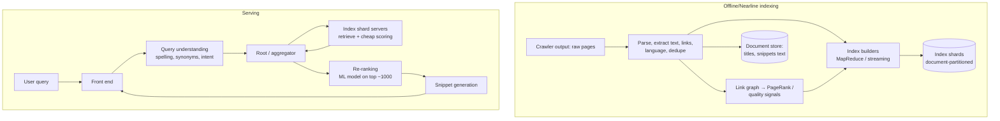

# 28. Design a Web Search Engine (Google Search)

## Interview question

> Design the core of a web search engine: given a query like "best hiking boots for winter", return the 10 most relevant web pages out of billions in under 300 ms. Assume a crawler already fetches pages (see [Web Crawler](07-web-crawler.md)); focus on indexing, retrieval, and ranking.

## Clarifying questions

| Question | Assumed answer |
|----------|----------------|
| Index size | 50 billion pages |
| Query volume | 100k queries/s peak |
| Latency | p99 < 300 ms end to end |
| Freshness | News within minutes; most pages days to weeks |
| Features in scope | Keyword + semantic retrieval, ranking, snippets, spell correction; ads/images out of scope |

## Requirements

**Functional:** index crawled pages; answer queries with ranked results, titles, snippets; pagination; spell correction.
**Non-functional:** low latency at huge scale, high availability (partial results better than none), freshness for news, relevance quality.

## Estimation

- 50B pages × ~10 KB extracted text = 500 TB text; inverted index roughly comparable size after compression → **hundreds of TB**, sharded across thousands of machines (plus replicas).
- 100k QPS × fan-out to all index shards → each query touches every shard → shards must answer in ~tens of ms.

## Core data structure: the inverted index

```
term       → posting list (sorted doc IDs + term frequency + positions)
"hiking"   → [3, 17, 42, 108, ...]
"boots"    → [17, 42, 99, 108, ...]
"winter"   → [5, 17, 108, 230, ...]
query AND  → intersect lists → [17, 108, ...]
```

- Posting lists are **compressed** (delta encoding + variable-byte / PForDelta) so more fits in memory.
- Doc IDs are assigned so that high-quality pages get small IDs → can stop early once enough good results are found.

## High-level design



## Deep dive 1: partitioning the index

| Strategy | How | Pros | Cons |
|----------|-----|------|------|
| **Document-partitioned (chosen)** | Each shard holds a full inverted index for a subset of documents | Queries are parallel; a shard loss only loses some docs; easy to add documents | Every query fans out to every shard |
| Term-partitioned | Each shard holds posting lists for some terms | Query touches only shards for its terms | Huge lists for common terms; multi-term intersection across machines; hot spots |

Each shard is replicated (for QPS and availability). The root fans out to one replica per shard, gathers the top-K from each, and merges. Use **hedged requests** and timeouts: if a shard is slow, return results without it rather than blowing the latency budget.

## Deep dive 2: ranking in stages

1. **Retrieval (per shard):** find candidate docs matching the query (boolean/term matching + semantic vector retrieval for meaning-based matches) and score cheaply with BM25 + static quality (PageRank, spam score) → top ~1,000 per shard.
2. **Merge** at the root → global top ~1,000.
3. **Re-rank** with a learned model (gradient-boosted trees or transformer cross-encoders) using hundreds of features: text relevance in title/body/anchor text, freshness, page quality, user engagement signals, location, language.
4. **Diversity & policy:** dedupe near-identical results, limit results per domain, safe-search filtering.

**BM25** in one line: rewards query terms that appear often in the document (with diminishing returns) and are rare across the corpus, normalized by document length.

**PageRank** in one line: a page is important if important pages link to it — computed iteratively over the link graph offline.

## Deep dive 3: freshness

- Main index rebuilt/merged in large batches (hours–days).
- A small **real-time index** (minutes) for news and frequently changing pages, queried in parallel and merged — the same idea as LSM trees: small fresh segment + big stable segments.

## Deep dive 4: query understanding

- Spell correction ("hikng" → "hiking") from query logs and edit-distance models.
- Synonyms and stemming ("boots" ~ "boot"), entity recognition, intent detection (navigational vs informational vs local).
- Query autocomplete is a separate system ([Search Autocomplete](10-search-autocomplete.md)).

## Deep dive 5: caching and latency

- **Result cache** for popular queries (a large share of traffic repeats) at the front end — short TTL for news-sensitive queries.
- Posting lists for frequent terms kept in memory; SSDs for the rest.
- Latency budget example: front end 10 ms, query understanding 20 ms, shard retrieval 80 ms, re-rank 60 ms, snippets 30 ms, network 50 ms.

## Evaluation

- Offline: NDCG@10 on human-rated query sets (raters judge relevance with guidelines).
- Online: A/B tests on click-through, "good clicks" (long dwell), reformulation rate, abandonment.

## Trade-offs

| Choice | Pro | Con |
|--------|-----|-----|
| Document partitioning | Parallel, robust, simple updates | Fan-out to every shard |
| Multi-stage ranking | Expensive models only on few docs | Retrieval recall caps quality |
| Partial results on timeout | Meets latency SLO | Slightly lower quality sometimes |
| Batch + real-time index | Freshness without rebuilding everything | Merge complexity |

## Follow-up interview questions

**Q: Why not just use a vector database for everything?**
A: Semantic retrieval is great for meaning but weak on exact terms, rare names, and codes, and scoring billions of vectors with filters is costly. Production systems combine lexical (inverted index) and semantic retrieval, then re-rank — hybrid search (see [Semantic Search](../ai-system-design/06-semantic-search-vector-db.md)).

**Q: How do you fight web spam / SEO manipulation?**
A: Spam classifiers on content and link patterns (link farms), demote low-quality sites, use engagement signals carefully, and manual actions for egregious cases.

**Q: How would you add a generative "AI overview" answer?**
A: Retrieve top results as today, then run a RAG step: an LLM summarizes the top passages with citations (see [RAG](../ai-system-design/01-rag-enterprise-assistant.md)), with caching for popular queries and safety checks, shown only when confidence is high.
