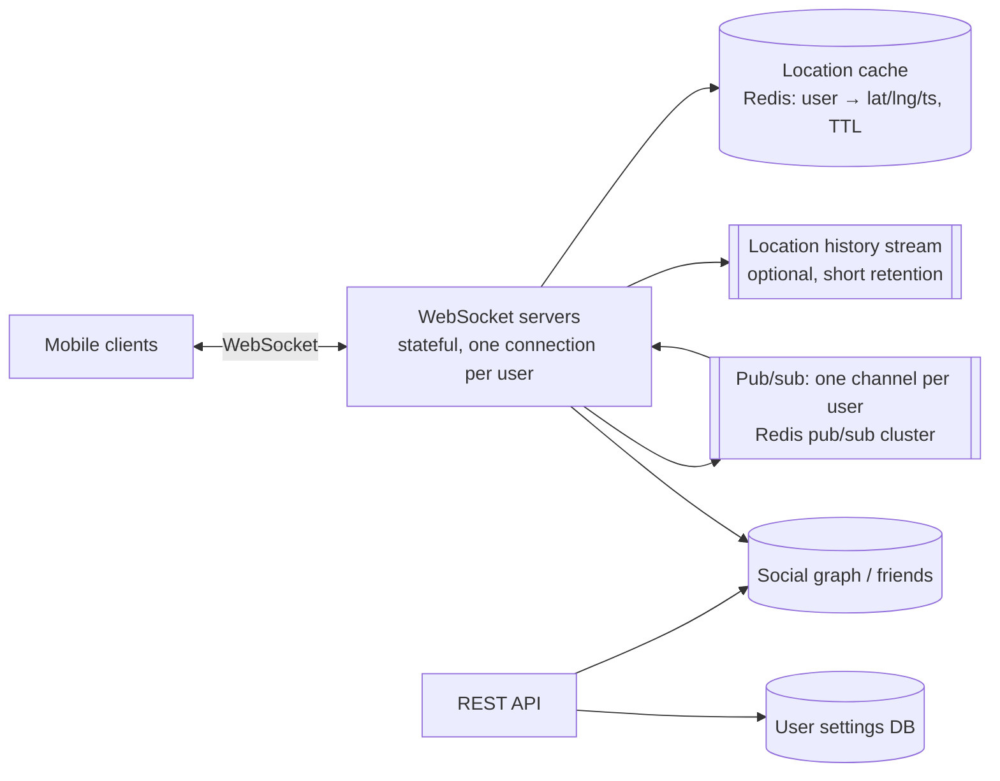

# 29. Design a Nearby Friends Feature (Live Location Sharing)

> 📚 **Further reading:** *System Design Interview – An Insider's Guide, Volume 2* by Alex Xu and Sahn Lam covers this problem. This solution is written independently.

## Interview question

> Design a feature that shows users which of their friends are nearby (within 5 miles) and updates their positions in near real time, like "Nearby Friends" in a social app. 100M daily users; 10% use the feature at any time.

## Clarifying questions

| Question | Assumed answer |
|----------|----------------|
| Radius | 5 miles, configurable |
| Update frequency | Clients send location every 30 seconds while the feature is active |
| Friends per user | ~400 on average, max 5,000 |
| Freshness | Positions in the list ≤ 1 minute old; show "last updated" |
| Privacy | Opt-in; users can pause sharing; location history retained briefly (if at all) |
| Inactive friends | Hide friends whose last update is older than ~10 minutes |

## How it differs from a proximity service

[Nearby search](19-proximity-service.md) finds **static** places; here **both sides move** and updates must be **pushed** continuously, and only to **friends** — it's a real-time pub/sub problem more than a geo-index problem.

## Requirements

**Functional:** opt in/out; send location updates; see a list of nearby friends with distance and freshness; receive live updates.
**Non-functional:** low latency (seconds), scale to millions of concurrent users and updates, privacy and data minimization, tolerate eventual consistency.

## Estimation

- Concurrent active users: 10M. Updates every 30 s → **~330k location updates/s**.
- Each update fans out to that user's **active** friends. If 10% of 400 friends are active → ~40 deliveries per update → **~13M messages/s** to evaluate (most filtered by distance).
- Location cache: 10M users × ~100 B = **~1 GB** (latest location only).

## API

```
WebSocket (client ↔ server)
→ { "type": "location", "lat": 37.77, "lng": -122.42, "ts": 1760000000 }
← { "type": "friend_location", "friend_id": 88, "lat": 37.78, "lng": -122.41, "distance_mi": 0.7, "ts": 1760000003 }

HTTP
GET  /v1/nearby-friends          → initial list on open
POST /v1/location-sharing        { "enabled": true }
```

## High-level design



## Deep dive 1: the update flow

1. User A's client sends a location update over its WebSocket.
2. The WebSocket server stores A's latest location in the **location cache** (TTL ~10 min → inactive users disappear automatically).
3. It **publishes** A's update to **A's own channel** in the pub/sub system.
4. Every active friend B of A has a WebSocket server that is **subscribed to A's channel** (subscribed when B connected).
5. B's server receives A's update, computes the distance between A and B (it knows B's latest location), and **only if within the radius** pushes it to B's client.

On connect, B's server fetches B's friend list, subscribes to each friend's channel, and reads friends' latest locations from the cache to build the initial list.

## Deep dive 2: scaling pub/sub

- Channels are cheap (a channel with no subscribers costs almost nothing), but 13M messages/s is a lot for one cluster.
- **Shard channels across many pub/sub servers** using consistent hashing on user ID; a service-discovery layer (etcd/ZooKeeper) holds the hash ring so WebSocket servers know where to publish/subscribe.
- Pub/sub nodes are mostly stateless relays (subscriber lists are rebuilt when WebSocket servers reconnect), so resizing the ring mainly causes a burst of resubscriptions — do it during low traffic.
- Alternative: a purpose-built messaging layer (e.g., NATS, Erlang/Elixir-based servers) designed for millions of lightweight subscriptions.

## Deep dive 3: WebSocket server fleet

- Stateful: each connection lives on one server; autoscale on connection count; **drain** servers gradually on deploy (mark unhealthy, let clients reconnect elsewhere with jittered backoff).
- Keep location computation on these servers (distance checks are cheap); the location cache is shared.

## Deep dive 4: privacy & battery

- Opt-in only, easy pause, coarse location option, no sharing with blocked users.
- Minimize retention: store only the latest location (TTL); any history kept for ML/analytics should be aggregated/anonymized with short retention.
- Client adaptivity: send less often when stationary or the app is in the background; server can tell clients to slow down under load.

## Variation: nearby **strangers** (random people nearby)

Friend channels no longer work. Instead, partition the map into **geohash cells**, have each cell be a channel, publish updates to the user's cell, and subscribe to the user's cell plus neighbors — like the [ride-sharing](09-ride-sharing.md) geo index.

## Trade-offs

| Choice | Pro | Con |
|--------|-----|-----|
| Per-user channels | Natural fan-out to friends only | Huge numbers of channels and subscriptions |
| Distance filtering at the receiver's server | Simple; sender doesn't need friends' locations | Some messages delivered to servers only to be dropped |
| Latest-location cache with TTL | Small, auto-expires inactive users | No history (by design) |
| WebSockets | Low latency both ways | Stateful servers, connection management |

## Follow-up interview questions

**Q: A celebrity with 5,000 active friends moves. What happens?**
A: Their update fans out to up to 5,000 subscribers across many WebSocket servers via the sharded pub/sub — bounded by the max friend count. For true broadcast accounts you'd sample or throttle updates (e.g., at most once a minute).

**Q: Why not compute nearby friends with a database query every 30 seconds?**
A: 10M users × 400 friends queried every 30 s is billions of lookups and distance computations per minute, and still not real time. Push-based pub/sub only does work when someone moves.

**Q: How do you handle a pub/sub node failure?**
A: Detect via health checks; update the hash ring; WebSocket servers resubscribe affected channels on the new nodes. A few seconds of missed updates are acceptable because the next location update (≤ 30 s) refreshes everything.
