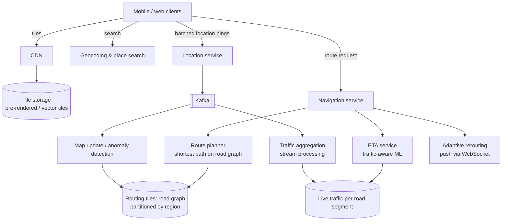

# 30. Design Google Maps (Map Tiles, Routing & ETA)

> 📚 **Further reading:** *System Design Interview – An Insider's Guide, Volume 2* by Alex Xu and Sahn Lam covers this problem. This solution is written independently.

## Interview question

> Design a maps application: users see a zoomable map of the world, search for places, get driving directions with an estimated time of arrival (ETA) that reflects live traffic, and receive turn-by-turn navigation with rerouting. 1B monthly users.

## Clarifying questions

| Question | Assumed answer |
|----------|----------------|
| Features in scope | Map rendering, routing (driving), ETA with traffic, navigation/rerouting; place search briefly |
| Platforms | Mobile (primary) and web |
| Data sources | Road network data, traffic from users' phones (opt-in location pings), incident reports |
| Accuracy | ETA within ~10% for most trips |
| Offline | Downloadable areas (follow-up) |

## Requirements

**Functional:** render map at any zoom; compute fastest route A→B; live ETA; navigation with rerouting; location updates from users.
**Non-functional:** fast map loading globally, route computation in < 1 s, high availability, battery/data efficiency on mobile, massive read scale.

## Estimation

- **Map tiles:** the world at zoom levels 0–21. Zoom 21 has ~4.4 trillion 256×256 tiles — but most are ocean/empty and compress well; with deduplication and vector tiles, total storage is on the order of **tens to ~100 PB** for imagery-style raster, far less for vector tiles.
- **Location updates:** 1B MAU; say 100M daily navigators × pings every few seconds while navigating → **millions of location updates/s** → batch on the client (send every 15 s with multiple points).
- **Routing requests:** maybe 100k–1M per second at peak including reroutes.

## High-level design

## Deep dive 1: map tiles

- The world is projected (Web Mercator) and cut into a **quadtree of tiles**: zoom level z has 2^z × 2^z tiles; each tile is identified by (z, x, y) — easily computed from lat/lng.
- Pre-render tiles and serve them as static files from object storage via a **CDN** — static, cacheable, globally fast. URL like `/tiles/{z}/{x}/{y}.pbf`.
- **Vector tiles** (roads, labels as geometry) are much smaller than raster images, render crisply at any rotation/zoom, and let clients restyle (night mode) — the modern default.
- Clients request only the tiles visible in the viewport at the current zoom; cache tiles on device; download regions for offline use.

## Deep dive 2: routing

- Road network = a **weighted directed graph**: intersections are nodes, road segments are edges with weights (travel time).
- Plain Dijkstra/A* over a continent-sized graph is too slow per request. Production systems use **preprocessing**:
  - **Hierarchical routing / contraction hierarchies:** precompute shortcuts so long trips mostly traverse a small "highway" layer.
  - **Partitioned routing tiles:** split the graph into regions at several levels (local streets, arterials, highways); load only the tiles needed for a route.
- Precomputation runs offline whenever the road graph changes; live traffic adjusts edge weights (some algorithms support fast weight updates, e.g., customizable route planning).
- Return several candidate routes; the ETA service ranks them.

## Deep dive 3: ETA and live traffic

1. Navigating users send batched GPS pings (opt-in); points are **map-matched** to road segments (handling GPS noise).
2. A stream processor computes current speed per road segment (e.g., median over the last few minutes), weighting fresh data more.
3. ETA = sum of predicted segment travel times along the route, using **ML models** that blend live speeds with historical patterns (time of day, day of week, weather, events) to forecast traffic *when you'll reach* each segment.
4. Incidents (accidents, closures) from user reports and partners update the graph.

## Deep dive 4: navigation & rerouting

- During navigation the client tracks its position locally (no server round trip per turn) and follows the route.
- The server tracks active trips; when traffic changes enough that a faster route appears (or the user goes off route), compute a new route and **push** it via a persistent connection (WebSocket/push notification).
- Batch location uploads (every ~15 s) to save battery and data.

## Deep dive 5: place search (geocoding)

- **Geocoding:** address → coordinates; **reverse geocoding:** coordinates → address.
- Search index over places with text matching + location bias (rank nearby results higher) — similar to [proximity search](19-proximity-service.md) + [autocomplete](10-search-autocomplete.md).

## Trade-offs

| Choice | Pro | Con |
|--------|-----|-----|
| Pre-rendered tiles + CDN | Massive read scale, cheap | Storage; re-render on map changes |
| Vector tiles | Small, flexible styling | More client rendering work |
| Precomputed routing hierarchy | Millisecond-ish routes on huge graphs | Preprocessing pipeline; traffic updates need care |
| Client-side batching of pings | Battery and data savings | Slightly less fresh traffic data |

## Follow-up interview questions

**Q: How do you keep ETA accurate during rush hour?**
A: Predict future segment speeds, not just current ones: the model uses historical patterns for the expected arrival time at each segment plus live deviations, retrained continuously and evaluated against actual trip times.

**Q: How would you support offline navigation?**
A: Download vector tiles and routing tiles for a region to the device; run the route planner locally; sync traffic when back online.

**Q: How do you detect that a new road was built?**
A: Anomaly detection on GPS traces: many users consistently traveling where no road segment exists suggests a missing road → queue for map editors/automated graph updates.
