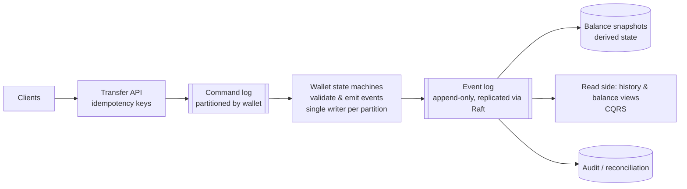

# 31. Design a Digital Wallet (Balance Transfers at Scale)

> 📚 **Further reading:** *System Design Interview – An Insider's Guide, Volume 2* by Alex Xu and Sahn Lam covers this problem; *Designing Data-Intensive Applications* (Kleppmann) covers the underlying transactions and event-sourcing ideas. This solution is written independently.

## Interview question

> Design a digital wallet where users hold a balance and transfer money to each other instantly (like a stored-value wallet in a payments app). Support 1 million transfers per second at peak. Balances must always be correct, and every change must be auditable and reproducible.

## Clarifying questions

| Question | Assumed answer |
|----------|----------------|
| Operations | Transfer between two wallets; top-up/withdraw via external payment rails (follow-up) |
| Scale | 1M transfers/s peak; hundreds of millions of wallets |
| Correctness | No money created or lost; no negative balances; exactly-once effect |
| Audit | Reconstruct any balance at any point in time; reproducible history |
| Latency | Transfer confirmed within ~1 s |
| Currency | Single currency (multi-currency is a follow-up) |

## Requirements

**Functional:** transfer A→B; get balance; transaction history.
**Non-functional:** strong correctness (atomic debit+credit), very high throughput, durability, availability, auditability/reproducibility.

## Why it's hard

A transfer touches **two accounts** that, at this scale, live on **different shards**. We need the atomicity of a transaction across shards — at 1M/s.

## Estimation

- 1M transfers/s → 2M balance updates/s.
- If one database node handles ~10k transactional writes/s, a naive design needs **hundreds of shards**, and most transfers become cross-shard.

## Approach 1: in-memory sharded balances (doesn't meet correctness)

Redis-style sharded key-value store of `wallet → balance`, updating both sides. Fast, but updates to two shards aren't atomic and memory isn't durable → rejected.

## Approach 2: distributed transactions across database shards

- **Two-phase commit** across the two shards: correct, but holds locks across network round trips and blocks if the coordinator fails ([2PC vs sagas](../fundamentals/systems/13-distributed-transactions-and-sagas.md)).
- **Try-Confirm/Cancel (TC/C)** or **sagas**: debit A (try) → credit B → confirm; compensate on failure. No long locks, but intermediate states are visible and compensation logic must be perfect.
- Works at moderate scale; complex at 1M/s with heavy cross-shard traffic.

## Approach 3 (chosen): event sourcing + sharded state machines

### Core ideas
1. **Commands** (requests like "transfer $10 from A to B with key K") are written to a durable, ordered **command log**.
2. A **state machine** consumes commands in order, **validates** them against current state (sufficient balance? duplicate key?), and emits **events** ("A debited $10", "B credited $10").
3. Events are appended to an immutable, replicated **event log** — the source of truth. Balances are **derived** by applying events; snapshots speed up recovery.
4. Because processing is deterministic and the log is ordered, replaying events always reproduces the same balances → **reproducibility and audit for free**.

### Making it fast
- **Single writer per partition, in memory:** each partition's state machine keeps its wallets' balances in memory and processes commands sequentially (no locks), like the [stock exchange](21-stock-exchange.md) matching engine. Throughput comes from many partitions.
- **Durability via a replicated log:** append events to a Raft-replicated log (or Kafka with acks=all) so a node failure loses nothing ([Raft](../fundamentals/systems/12-consensus-and-raft.md)).
- **Cross-partition transfers:** model as a small saga between partitions — partition(A) emits "A debited, transfer T pending", partition(B) consumes it and emits "B credited, T completed"; if B's side fails validation, partition(A) consumes a compensation event and re-credits A. Every step is idempotent and keyed by transfer ID.
- **CQRS:** the write side (state machines) is optimized for validation; read views (balance, history) are built asynchronously from events.

## Idempotency & exactly-once effect

- Clients send an idempotency key per transfer; state machines remember processed keys (within the partition) and ignore duplicates.
- Event consumers dedupe by event ID; downstream sinks are idempotent ([payments](12-payment-system.md)).

## Reconciliation & invariants

- Global invariant: sum of all balances + money in transit = total money in the system (minus external top-ups/withdrawals tracked separately).
- Continuous checks on the event stream; daily reconciliation against external payment rails.

## Trade-offs

| Approach | Pro | Con |
|----------|-----|-----|
| Sharded relational + 2PC | Familiar ACID semantics | Lock contention, blocking, limited throughput |
| Sagas / TC/C | No long locks | Visible intermediate states, complex compensations |
| Event sourcing + in-memory state machines | Very high throughput, perfect audit/replay | Complex engineering; careful snapshotting; eventual consistency for reads |

## Follow-up interview questions

**Q: How do you rebuild a wallet's balance after a bug is found in the balance calculation?**
A: Fix the state-machine code and replay the event log (from a snapshot taken before the bug or from the beginning) to produce corrected balances — events themselves are immutable facts.

**Q: How do you prevent negative balances under concurrency?**
A: All commands for a wallet go to one partition processed by a single writer in order, so validation ("balance ≥ amount") and the debit happen atomically with no race.

**Q: What happens if a partition leader crashes mid-transfer?**
A: A follower with the replicated log becomes leader, rebuilds in-memory state from the last snapshot plus the log, and continues; uncommitted commands are retried by clients using the same idempotency keys, so nothing is applied twice.
