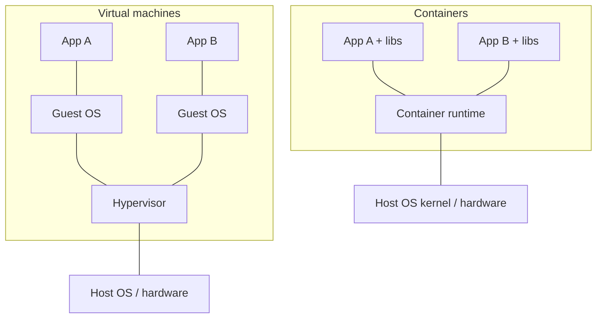

# Docker 1: Containers & Docker Basics

> **In one sentence:** a container packages your app with everything it needs (runtime, libraries, config) so it runs the same on your laptop, a CI server, and production.

**Level:** Beginner · **You'll learn:** what containers are, images vs containers, the essential Docker commands.

## Everyday analogy

Before shipping containers, cargo was loaded piece by piece — sacks, barrels, crates — and every port handled it differently. The **shipping container** standardized the box: any ship, train, or truck can carry it without caring what's inside. Docker does the same for software: any machine with a container runtime can run any container.

## See it in action: the container lifecycle

<div class="sim" data-sim="pipeline" data-title="From code to running container" data-steps="Write a Dockerfile|docker build|Image|docker push|Registry|docker pull|docker run|Container" data-labels="A recipe: base image, files, commands|Execute the recipe, layer by layer|Read-only template (like a class)|Upload the image|Docker Hub, GHCR, ECR, GCR store images|Download on any machine|Start a process from the image|Running instance (like an object)"><em>Interactive animation available on the website.</em></div>

## The problem containers solve

"It works on my machine" happens because environments differ: Python 3.10 vs 3.12, a missing system library, a different OS. Containers ship the environment *with* the app.

## Containers vs virtual machines

| | Virtual machine | Container |
|---|---|---|
| Includes | A full guest OS + kernel | Just the app + its libraries; shares the host kernel |
| Size | Gigabytes | Megabytes |
| Start time | Minutes | Milliseconds to seconds |
| Isolation | Strong (hardware virtualization) | Process-level (Linux namespaces + cgroups) |
| Density | Tens per host | Hundreds per host |

Under the hood, a container is just a Linux process with:
- **Namespaces** — its own view of processes, network, filesystem, hostname.
- **cgroups** — limits on CPU and memory.
- **A layered filesystem** — the image's read-only layers plus a thin writable layer.



## Key vocabulary

| Term | Meaning |
|------|---------|
| **Image** | Read-only template: filesystem layers + metadata (what command to run). Built from a Dockerfile. |
| **Container** | A running (or stopped) instance of an image. You can run many containers from one image. |
| **Dockerfile** | Text file with build instructions. |
| **Registry** | Server that stores images (Docker Hub, GitHub Container Registry `ghcr.io`, AWS ECR…). |
| **Tag** | A version label: `python:3.12-slim`, `myapp:1.4.0`, `myapp:sha-a1b2c3d`. |
| **Volume** | Persistent storage that outlives a container. |

## Install and verify

Install **Docker Desktop** (Mac/Windows) or **Docker Engine** (Linux), then:

```bash
docker version          # client and server versions
docker run hello-world  # pulls a tiny image and runs it
```

## Essential commands

```bash
# Images
docker pull nginx:1.27            # download an image
docker images                     # list local images
docker rmi nginx:1.27             # delete an image

# Run containers
docker run -d --name web -p 8080:80 nginx:1.27
#   -d          run in background (detached)
#   --name web  give it a name
#   -p 8080:80  map host port 8080 → container port 80
#   then open http://localhost:8080

docker ps                         # running containers
docker ps -a                      # all containers, including stopped
docker logs -f web                # follow logs
docker exec -it web sh            # open a shell inside the running container
docker stop web && docker rm web  # stop and remove

# Environment variables and auto-remove
docker run --rm -e GREETING=hi alpine:3.20 sh -c 'echo $GREETING'

# Clean up unused stuff
docker system prune               # removes stopped containers, unused networks, dangling images
```

## Try it: run the tutorial app

This repo includes a small web app used across all DevOps lessons: [`examples/app`](examples/app/app.py).

```bash
cd devops/examples/app
docker build -t notes-api:dev .
docker run --rm -p 8080:8080 notes-api:dev
curl http://localhost:8080/healthz      # {"status":"ok"}
```

## Common mistakes

- **Using `latest` tags in production** — you can't tell what's running or roll back reliably. Use explicit versions or commit SHAs.
- **Storing data inside the container** — it disappears when the container is removed. Use volumes.
- **Running as root** inside containers — use a non-root user (covered in the next lesson).
- Forgetting `-p` and wondering why `localhost` doesn't respond.

## Quick check

**Q: What's the difference between an image and a container?**

A: An image is the read-only template (like a class); a container is a running instance created from it (like an object). One image can start many containers.

**Q: Why do containers start so much faster than VMs?**

A: They don't boot an operating system — they're ordinary processes on the host kernel, isolated with namespaces and limited with cgroups.

**Next:** [Writing Dockerfiles](02-writing-dockerfiles.md)
