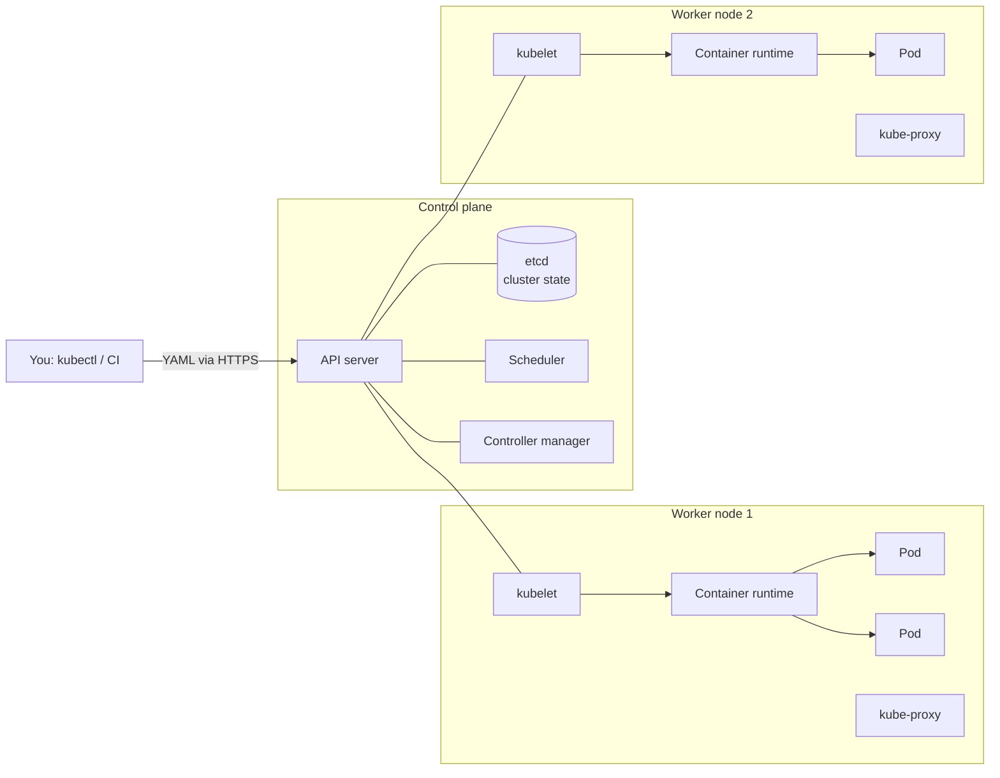

# Kubernetes 1: Architecture & Core Concepts

> **In one sentence:** Kubernetes runs your containers across a cluster of machines and constantly works to make the real state match the state you declared in YAML — restarting, rescheduling, and scaling automatically.

**Level:** Beginner · **You'll learn:** why Kubernetes exists, the control plane and nodes, pods, the reconciliation loop, and your first `kubectl` commands.

## Everyday analogy

A thermostat: you set the desired temperature (21 °C); it measures the room and turns heating on or off until reality matches. You never say "heat for 10 minutes". Kubernetes works the same way: you declare "3 copies of my app", and controllers keep checking and fixing until there are exactly 3 running — even when machines die.

## See it in action: self-healing & scaling

<div class="sim" data-sim="k8s-self-heal"><em>Interactive animation available on the website.</em></div>

Kill a pod or fail a whole node: the controller notices the gap between **desired** and **actual** and creates replacements. Change the replica count to scale.

## What Kubernetes gives you

| Problem with plain containers | Kubernetes feature |
|-------------------------------|--------------------|
| A container crashes at 3 am | Restarts it automatically; replaces failed pods |
| A server dies | Reschedules its pods onto healthy nodes |
| Traffic doubles | Scale replicas manually or with autoscalers |
| Deploying a new version | Rolling updates with automatic rollback |
| Finding other services | Built-in DNS and load-balanced Services |
| Config and secrets | ConfigMaps and Secrets injected at runtime |
| Packing apps onto machines | A scheduler that bin-packs by CPU/memory requests |

## Cluster architecture



| Component | Role |
|-----------|------|
| **API server** | Front door. Every change (from you, controllers, nodes) goes through it. |
| **etcd** | Consistent key-value store holding the entire cluster state. Back it up! |
| **Scheduler** | Picks a node for each new pod based on resources, affinity, taints. |
| **Controller manager** | Runs control loops (Deployment, ReplicaSet, Node, Job controllers…). |
| **kubelet** | Agent on every node; starts/stops containers to match the pods assigned to it, reports status. |
| **Container runtime** | containerd / CRI-O actually runs containers. |
| **kube-proxy** | Programs node networking so Service IPs route to pods. |

Managed services (EKS, GKE, AKS) run the control plane for you; you manage workloads (and often nodes).

## The reconciliation loop (the key idea)

1. You `kubectl apply` a manifest: *"desired state: 3 replicas of notes-api:1.2"*.
2. It's stored in etcd via the API server.
3. Controllers **watch** for differences between desired and actual state.
4. They act (create pods, the scheduler assigns nodes, kubelets start containers).
5. Repeat forever.

This is why Kubernetes is **declarative**: you describe *what*, not *how*. Re-applying the same YAML is safe (idempotent).

## Core objects at a glance

| Object | What it is |
|--------|-----------|
| **Pod** | Smallest unit: one or more containers sharing network (same IP) and storage. Ephemeral. |
| **Deployment** | Manages stateless pods: replicas, rolling updates, rollbacks. |
| **Service** | Stable name + IP that load-balances to a set of pods. |
| **Ingress** | HTTP routing from outside the cluster to Services. |
| **ConfigMap / Secret** | Configuration and sensitive values for pods. |
| **Namespace** | Virtual cluster for grouping and isolating resources (e.g., `staging`, `prod`). |
| **PersistentVolumeClaim** | Request for durable storage. |

Labels (`app: notes-api`) are how objects find each other: Services and Deployments use **label selectors**.

## Your first cluster and commands

Local clusters: **kind** (Kubernetes in Docker), **minikube**, **k3d**, or Docker Desktop's built-in Kubernetes.

```bash
kind create cluster --name learn
kubectl cluster-info
kubectl get nodes

# Imperative quick start (good for learning, not for production)
kubectl create deployment hello --image=nginx:1.27 --replicas=2
kubectl expose deployment hello --port=80
kubectl get pods -o wide
kubectl port-forward svc/hello 8080:80      # then open http://localhost:8080

# Watch self-healing
kubectl delete pod -l app=hello --wait=false
kubectl get pods -w                          # new pods appear

# Scale
kubectl scale deployment hello --replicas=5

# Inspect and debug
kubectl describe pod <name>                  # events explain most problems
kubectl logs <pod> [-c container] [-f] [--previous]
kubectl exec -it <pod> -- sh

# Clean up
kubectl delete deployment,service hello
```

### Declarative workflow (what you'll use for real)

```bash
kubectl apply -f deployment.yaml     # create or update to match the file
kubectl diff -f deployment.yaml      # preview changes
kubectl delete -f deployment.yaml
kubectl apply -k overlays/staging    # Kustomize directory (covered later)
```

### kubectl power tips
```bash
kubectl get pods -A                      # all namespaces
kubectl config set-context --current --namespace=notes-staging
kubectl get deploy notes-api -o yaml     # see the full live object
kubectl explain pod.spec.containers.resources
alias k=kubectl
```

## Quick check

**Q: You delete a pod managed by a Deployment. What happens and why?**

A: A new pod is created almost immediately. The ReplicaSet controller sees actual replicas (2) < desired (3) and creates a replacement — the reconciliation loop.

**Q: Which component decides which node a pod runs on?**

A: The scheduler. The kubelet on that node then starts the containers.

**Next:** [Workloads: Pods, Deployments, StatefulSets, Jobs](06-kubernetes-workloads.md)
