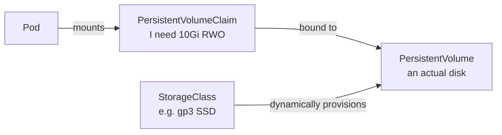

# Kubernetes 4: Configuration & Storage — ConfigMaps, Secrets, Volumes

> **In one sentence:** keep configuration and secrets out of your image by injecting them at runtime with ConfigMaps and Secrets, and give stateful apps durable disks with PersistentVolumeClaims.

**Level:** Intermediate · **You'll learn:** ConfigMaps, Secrets (and how to keep them safe), volume types, PV/PVC/StorageClass.

## See it in action

<div class="sim" data-sim="pipeline" data-title="How a pod gets config and storage" data-steps="ConfigMap|Secret|PVC|StorageClass|PersistentVolume|Pod starts|Container" data-labels="GREETING, REDIS_URL (plain config)|DB password (sensitive)|I need 10Gi ReadWriteOnce|Knows how to create disks (e.g. cloud SSD)|A real disk is provisioned|kubelet mounts volumes, sets env vars|Reads env vars and files at /data"><em>Interactive animation available on the website.</em></div>

## Principle: build once, configure per environment

The same image runs in dev, staging, and production; only configuration changes (12-factor app). Never bake environment-specific values or secrets into images.

## ConfigMaps

```yaml
apiVersion: v1
kind: ConfigMap
metadata:
  name: notes-api-config
data:
  GREETING: "Hello from Kubernetes"
  REDIS_URL: "redis://redis:6379/0"
  app.properties: |           # a whole file as one key
    log.level=info
    feature.search=true
```

Three ways to consume:

```yaml
spec:
  containers:
    - name: api
      image: ghcr.io/nuvyaro/notes-api:1.0.0
      envFrom:                       # 1. all keys as env vars
        - configMapRef:
            name: notes-api-config
      env:
        - name: WELCOME_MESSAGE      # 2. one key as one env var (renamed)
          valueFrom:
            configMapKeyRef:
              name: notes-api-config
              key: GREETING
      volumeMounts:                  # 3. keys as files
        - name: config
          mountPath: /etc/notes
          readOnly: true
  volumes:
    - name: config
      configMap:
        name: notes-api-config
```

> Env vars are read once at startup — change a ConfigMap and you must restart pods (`kubectl rollout restart`). Mounted files update automatically (after a short delay), but your app must re-read them. Helm charts often add a checksum annotation so config changes trigger a rollout automatically.

## Secrets

Same shape as ConfigMaps, for sensitive data:

```bash
kubectl create secret generic notes-db \
  --from-literal=DB_PASSWORD='s3cr3t' \
  --dry-run=client -o yaml          # print YAML instead of creating
```

```yaml
env:
  - name: DB_PASSWORD
    valueFrom:
      secretKeyRef:
        name: notes-db
        key: DB_PASSWORD
```

**Important:** Secret values are only **base64-encoded**, not encrypted. Protect them:
1. Enable **encryption at rest** for etcd (managed clusters usually do).
2. Restrict access with **RBAC** (`get secrets` is powerful).
3. **Never commit plain Secrets to git.** Use one of:
   - **External Secrets Operator** — syncs from AWS Secrets Manager / GCP Secret Manager / Vault.
   - **Sealed Secrets** — encrypt with the cluster's public key; safe to commit.
   - **SOPS** — encrypt YAML files with KMS/age keys (works with Helm/Kustomize/Argo CD).
4. Prefer files over env vars for very sensitive values (env vars can leak into logs and crash dumps).

## Volumes

| Volume type | Lifetime | Use |
|-------------|----------|-----|
| `emptyDir` | As long as the pod | Scratch space, sharing files between containers, writable `/tmp` with a read-only root FS |
| `configMap` / `secret` | Tied to the object | Config files |
| `persistentVolumeClaim` | Independent of pods | Databases, uploads |
| `hostPath` | The node's disk | Node agents only (security risk otherwise) |
| `projected` | — | Combine several sources (e.g., service account token + config) |

## Persistent storage: PV, PVC, StorageClass



- **PersistentVolumeClaim (PVC):** an app's request — "10 GiB, ReadWriteOnce".
- **StorageClass:** a template for creating disks (cloud SSD, network storage); enables **dynamic provisioning**.
- **PersistentVolume (PV):** the actual disk, created automatically for the claim.

```yaml
apiVersion: v1
kind: PersistentVolumeClaim
metadata:
  name: uploads
spec:
  accessModes: ["ReadWriteOnce"]   # mounted read-write by one node
  storageClassName: standard       # omit to use the cluster default
  resources:
    requests:
      storage: 10Gi
---
# in a pod spec
volumes:
  - name: uploads
    persistentVolumeClaim:
      claimName: uploads
```

| Access mode | Meaning |
|-------------|---------|
| `ReadWriteOnce` (RWO) | Read-write by a single node (most block storage) |
| `ReadOnlyMany` (ROX) | Read-only by many nodes |
| `ReadWriteMany` (RWX) | Read-write by many nodes (NFS, EFS, CephFS) |
| `ReadWriteOncePod` | Read-write by a single pod |

**Reclaim policy:** `Delete` (disk removed with the PVC — default for dynamic provisioning) or `Retain` (keep the disk; use for important data). Back up with Velero or volume snapshots.

## Quick check

**Q: You updated a ConfigMap but the app still uses old values from env vars. Why?**

A: Environment variables are set when the container starts. Restart the pods (`kubectl rollout restart deployment/notes-api`) or change the pod template (e.g., a config checksum annotation).

**Q: Is a Kubernetes Secret encrypted?**

A: Not by itself — values are base64-encoded. Security comes from etcd encryption at rest, RBAC, and keeping plaintext secrets out of git (External Secrets, Sealed Secrets, SOPS).

**Next:** [Production readiness](09-kubernetes-production-readiness.md)
