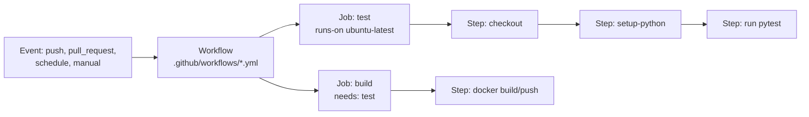

# CI/CD 1: Pipelines with GitHub Actions

> **In one sentence:** CI/CD automatically tests every change, builds a container image, and deploys it through staging to production — so shipping is frequent, boring, and safe.

**Level:** Intermediate → Advanced · **You'll learn:** CI vs CD, GitHub Actions YAML syntax, a complete pipeline (test → build → scan → push → deploy), secrets, environments and approvals, plus a GitLab CI equivalent.

## See it in action

<div class="sim" data-sim="pipeline" data-title="The pipeline in this lesson" data-steps="git push|Lint & test|Build image|Scan|Push to GHCR|Deploy staging|Smoke test|Approve|Deploy production" data-labels="Triggers the workflow|ruff + pytest|docker buildx with layer cache|Trivy fails on CRITICAL/HIGH CVEs|Tagged with the commit SHA|kustomize edit set image + kubectl apply|curl /healthz must succeed|Required reviewer on the production environment|Same image, rollout + auto rollback"><em>Interactive animation available on the website.</em></div>

## CI vs CD

| Term | Meaning |
|------|---------|
| **Continuous Integration (CI)** | Every push/PR is automatically built and tested; problems are found in minutes |
| **Continuous Delivery** | Every change that passes CI is *ready* to release; production deploy is one click/approval |
| **Continuous Deployment** | Every passing change goes to production automatically |

Golden rules:
1. **Build once, deploy many** — the exact image tested in staging is promoted to production (tag by commit SHA).
2. **Everything as code** — pipeline, infrastructure, manifests in git.
3. **Fast feedback** — PR checks in under ~10 minutes; cache dependencies and layers.
4. **Fail safe** — automatic rollback on failed rollout; gates before production.

## GitHub Actions concepts



| Concept | Meaning |
|---------|---------|
| **Workflow** | A YAML file in `.github/workflows/` |
| **Event / trigger** (`on:`) | What starts it: `push`, `pull_request`, `schedule`, `workflow_dispatch` (manual), `release` |
| **Job** | A set of steps on one runner; jobs run in parallel unless linked with `needs:` |
| **Step** | A shell command (`run:`) or a reusable **action** (`uses:`) |
| **Runner** | The VM/container executing a job (GitHub-hosted or self-hosted) |
| **Secrets / variables** | Encrypted values (`${{ secrets.X }}`) and plain config (`${{ vars.X }}`) |
| **Environment** | Named target (staging, production) with its own secrets and protection rules (approvals) |
| **Artifacts / cache** | Share files between jobs; speed up dependency installs |

### A minimal CI workflow

```yaml
name: ci
on:
  pull_request:
  push:
    branches: [main]
jobs:
  test:
    runs-on: ubuntu-latest
    steps:
      - uses: actions/checkout@v4
      - uses: actions/setup-python@v5
        with:
          python-version: "3.12"
          cache: pip
      - run: pip install -r requirements.txt pytest
      - run: pytest -q
```

### Expressions, conditions, matrices

```yaml
jobs:
  test:
    strategy:
      matrix:
        python: ["3.11", "3.12"]      # runs the job twice in parallel
    runs-on: ubuntu-latest
    steps:
      - uses: actions/setup-python@v5
        with:
          python-version: ${{ matrix.python }}
      - run: echo "Only on main"
        if: github.ref == 'refs/heads/main'
```

## The complete pipeline

The full, working workflow is in [`examples/github-actions/ci-cd.yml`](examples/github-actions/ci-cd.yml) (it passes `actionlint`). To use it, copy it to `.github/workflows/ci-cd.yml`. Key parts:

### Triggers, concurrency, least-privilege permissions
```yaml
on:
  push:
    branches: [main]
  pull_request:
    branches: [main]
  workflow_dispatch:

concurrency:                       # cancel superseded runs
  group: ${{ github.workflow }}-${{ github.ref }}
  cancel-in-progress: true

permissions:
  contents: read                   # default token can only read; jobs opt in to more
```

### Job 1 — lint & test
```yaml
  test:
    runs-on: ubuntu-latest
    steps:
      - uses: actions/checkout@v4
      - uses: actions/setup-python@v5
        with:
          python-version: "3.12"
          cache: pip
          cache-dependency-path: devops/examples/app/requirements.txt
      - run: pip install -r requirements.txt pytest ruff
        working-directory: devops/examples/app
      - run: ruff check .
        working-directory: devops/examples/app
      - run: pytest -q
        working-directory: devops/examples/app
```

### Job 2 — build, scan, push the image
```yaml
  build:
    needs: test
    runs-on: ubuntu-latest
    permissions:
      contents: read
      packages: write              # allow pushing to ghcr.io with GITHUB_TOKEN
    outputs:
      image: ${{ steps.vars.outputs.image }}
      tag: ${{ steps.vars.outputs.tag }}
    steps:
      - uses: actions/checkout@v4
      - id: vars
        run: |
          echo "image=$(echo "ghcr.io/${{ github.repository_owner }}/notes-api" | tr '[:upper:]' '[:lower:]')" >> "$GITHUB_OUTPUT"
          echo "tag=sha-${GITHUB_SHA::7}" >> "$GITHUB_OUTPUT"
      - uses: docker/setup-buildx-action@v3
      - uses: docker/login-action@v3
        if: github.event_name != 'pull_request'
        with:
          registry: ghcr.io
          username: ${{ github.actor }}
          password: ${{ secrets.GITHUB_TOKEN }}
      - uses: docker/build-push-action@v6
        with:
          context: devops/examples/app
          load: true                                   # keep locally for scanning
          tags: ${{ steps.vars.outputs.image }}:${{ steps.vars.outputs.tag }}
          cache-from: type=gha                         # reuse layers across runs
          cache-to: type=gha,mode=max
      - uses: aquasecurity/trivy-action@0.24.0
        with:
          image-ref: ${{ steps.vars.outputs.image }}:${{ steps.vars.outputs.tag }}
          severity: CRITICAL,HIGH
          ignore-unfixed: true
          exit-code: "1"                               # fail the build on serious CVEs
      # …then push (only on main) with the same tags
```

### Job 3 — validate manifests (in parallel with build)
```yaml
  validate-manifests:
    needs: test
    runs-on: ubuntu-latest
    steps:
      - uses: actions/checkout@v4
      - uses: imranismail/setup-kustomize@v2
      - run: |
          curl -sSL https://github.com/yannh/kubeconform/releases/download/v0.6.7/kubeconform-linux-amd64.tar.gz | tar xz
          for env in staging production; do
            kustomize build devops/examples/k8s/overlays/$env | ./kubeconform -strict -summary
          done
```

### Jobs 4 & 5 — deploy to staging, then production with approval
```yaml
  deploy-staging:
    needs: [build, validate-manifests]
    if: github.event_name == 'push' && github.ref == 'refs/heads/main'
    environment:
      name: staging
      url: https://staging.notes.example.com
    runs-on: ubuntu-latest
    steps:
      - uses: actions/checkout@v4
      - uses: imranismail/setup-kustomize@v2
      - uses: azure/setup-kubectl@v4
      - run: |
          mkdir -p ~/.kube
          echo "${{ secrets.KUBECONFIG_STAGING }}" | base64 -d > ~/.kube/config
      - working-directory: devops/examples/k8s/overlays/staging
        run: |
          kustomize edit set image notes-api=${{ needs.build.outputs.image }}:${{ needs.build.outputs.tag }}
          kustomize build . | kubectl apply -f -
          kubectl -n notes-staging rollout status deployment/notes-api --timeout=180s
      - run: curl --fail --retry 5 --retry-delay 5 https://staging.notes.example.com/healthz

  deploy-production:
    needs: [build, deploy-staging]
    environment:
      name: production             # add "Required reviewers" in Settings → Environments
    # same steps with the production overlay, plus:
    #   kubectl rollout status … || kubectl rollout undo …
```

### Setting it up
1. **Settings → Environments:** create `staging` and `production`; on `production` add **required reviewers** (the approval gate) and restrict it to the `main` branch.
2. Add `KUBECONFIG_STAGING` / `KUBECONFIG_PRODUCTION` as environment secrets (`base64 -w0 < kubeconfig`). Better: use your cloud's **OIDC federation** (e.g., `aws-actions/configure-aws-credentials` with `id-token: write`) so no long-lived credentials are stored at all.
3. **Branch protection** on `main`: require the `test`, `build`, and `validate-manifests` checks to pass before merging.

## Pipeline security essentials

- Least-privilege `permissions:` per job; never `write-all`.
- Pin third-party actions to a version (or full commit SHA for maximum safety).
- Don't run privileged steps on `pull_request_target` with untrusted code.
- Short-lived cloud credentials via OIDC instead of static keys.
- Scan dependencies and images; sign images (cosign) and generate SBOMs for supply-chain security.

## The same pipeline in GitLab CI (for comparison)

```yaml
stages: [test, build, deploy]

variables:
  IMAGE: $CI_REGISTRY_IMAGE/notes-api:$CI_COMMIT_SHORT_SHA

test:
  stage: test
  image: python:3.12-slim
  script:
    - cd devops/examples/app
    - pip install -r requirements.txt pytest
    - pytest -q

build:
  stage: build
  image: docker:27
  services: [docker:27-dind]
  script:
    - docker login -u $CI_REGISTRY_USER -p $CI_REGISTRY_PASSWORD $CI_REGISTRY
    - docker build -t $IMAGE devops/examples/app
    - docker push $IMAGE
  rules:
    - if: $CI_COMMIT_BRANCH == $CI_DEFAULT_BRANCH

deploy_production:
  stage: deploy
  image: bitnami/kubectl:1.30
  environment: production
  when: manual                     # approval gate
  script:
    - cd devops/examples/k8s/overlays/production
    - kubectl kustomize . | sed "s#ghcr.io/nuvyaro/notes-api:latest#$IMAGE#" | kubectl apply -f -
  rules:
    - if: $CI_COMMIT_BRANCH == $CI_DEFAULT_BRANCH
```

## Quick check

**Q: Why tag images with the commit SHA instead of `latest`?**

A: SHA tags are immutable and traceable: you know exactly which code is running, staging and production run the identical artifact, and rollback means redeploying a previous SHA.

**Q: How do you add a manual approval before production in GitHub Actions?**

A: Put the deploy job in an environment (`environment: production`) and configure required reviewers on that environment in repository settings; the job pauses until approved.

**Next:** [GitOps & deployment strategies](12-gitops-and-deployment-strategies.md)
