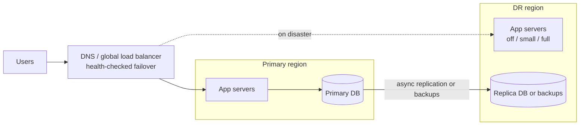

# Reliability 1: Disaster Recovery & Business Continuity

> **In one sentence:** disaster recovery (DR) is your plan for getting systems and data back after something destroys them — a region outage, earthquake, flood, fire, ransomware, or a bad command — measured by how long you're down (**RTO**) and how much data you lose (**RPO**).

**Level:** Intermediate → Advanced · **You'll learn:** RTO/RPO, the disaster types to plan for, the four DR strategies and their costs, and how to write and test a DR plan.

## Everyday analogy

Your house could flood. You keep copies of important documents at a relative's house (**backups off-site**). How quickly you can move into a temporary place (**RTO**) and how many recent documents you'd lose since your last copy (**RPO**) depend on how much you prepared — a spare furnished apartment (expensive, instant) versus a box of copies in a garage (cheap, slow to rebuild life from).

## See it in action

<div class="sim" data-sim="dr-strategies"><em>Interactive animation available on the website.</em></div>

Pick a strategy and trigger the earthquake. Compare how long each takes to recover, how much data is lost, and how much it costs every month.

## RTO and RPO

```
           last good backup / replica point        disaster            service restored
  ─────────────────●───────────────────────────────────💥──────────────────────●──────▶ time
                   |◀────────── RPO (data lost) ──────▶|◀──── RTO (downtime) ──▶|
```

| Term | Question it answers | Example target |
|------|---------------------|----------------|
| **RTO** (Recovery Time Objective) | How long can we be down? | 4 hours for internal tools, 5 minutes for checkout |
| **RPO** (Recovery Point Objective) | How much recent data can we lose? | 24 hours for analytics, ~0 for payments |
| **MTTR** | How long do recoveries actually take on average? | Measured from incidents and drills |

Targets come from the **business**, not engineering: estimate the cost of downtime and data loss per hour (lost revenue, SLA penalties, legal exposure, reputation) and spend accordingly. Do a **business impact analysis** per system — not everything needs the same tier.

## What counts as a "disaster"

| Category | Examples | What it destroys | Key defense |
|----------|----------|------------------|-------------|
| **Natural disasters** | Earthquake, flood, hurricane, wildfire, extreme heat | A whole data center or region (power, cooling, network) | A second region **far away** (different seismic zone, flood plain, power grid) |
| **Infrastructure failures** | Power loss, cooling failure, fiber cut, cloud region outage | A zone or region | Multi-AZ by default; multi-region for critical systems |
| **Human error** | `DROP TABLE`, deleting the wrong bucket, bad config push | Data or config — replicated instantly everywhere! | Point-in-time backups, deletion protection, peer review, least privilege |
| **Software bugs** | Data corruption from a bad release | Data, silently, over time | Versioned backups with long enough retention to go back before the bug |
| **Cyberattacks** | Ransomware, compromised admin credentials | Data and backups, deliberately | **Immutable, isolated backups** (object lock, separate accounts) |
| **Provider / vendor loss** | SaaS outage, account suspension, vendor bankruptcy | Access to a dependency | Exportable data, alternatives, contracts |
| **People & process** | Key engineer unavailable, lost credentials | The ability to execute recovery | Runbooks, break-glass access, trained backups |

> **Replication is not a backup.** Replication copies mistakes and corruption to every replica within milliseconds. You need both: replicas for availability, backups for going back in time.

## The four DR strategies

| Strategy | What runs in the DR region | Typical RTO | Typical RPO | Cost |
|----------|----------------------------|-------------|-------------|------|
| **Backup & restore** | Nothing — only backups stored there | Hours to a day | Hours (backup interval) | $ |
| **Pilot light** | Core data replicated (DB replica); app servers off | Tens of minutes | Minutes (replication lag) | $$ |
| **Warm standby** | A scaled-down full copy of production, running | Minutes | Seconds to minutes | $$$ |
| **Multi-site active-active** | Full production serving live traffic in both | Near zero | Near zero (with careful data design) | $$$$ |



Most companies use **tiers**: active-active for checkout and login, warm standby for core APIs, backup & restore for internal tools and analytics.

## Building blocks of a DR setup

1. **Infrastructure as Code** so the DR environment can be created or rebuilt identically (see [Terraform](18-infrastructure-as-code-terraform.md)).
2. **Data replication and backups** to another region and another account (see [Backup & restore](16-backup-and-restore.md)).
3. **Traffic failover** with health-checked DNS or a global load balancer — the [example Terraform](examples/reliability/terraform/dns-failover.tf) uses Route 53 failover records with a 60-second TTL.
4. **Container images and artifacts** replicated to registries in the DR region (a region outage can take your registry down too).
5. **Secrets and configuration** available in the DR region (vault replication, parameter stores).
6. **Runbooks** that someone who has never done it can follow at 3 a.m.
7. **Regular drills** — an untested DR plan is a hope, not a plan (see [Chaos engineering & DR drills](21-chaos-engineering-and-dr-drills.md)).

## Writing a DR plan (template)

```markdown
## System: notes-api        Tier: 2       RTO: 30 min      RPO: 5 min
Owner: platform-team (primary on-call)   Backup owner: sre-team

### Dependencies
PostgreSQL (replica in us-west-2), Redis (rebuildable cache), S3 uploads (CRR to us-west-2), container registry (replicated)

### Trigger
Declare a disaster when the primary region is unavailable > 15 min, or on cloud provider region-wide incident. Incident commander decides.

### Steps
1. Announce in #incident; page DR roles (IC, ops lead, comms).
2. Freeze deployments in the primary region.
3. Promote the us-west-2 database replica (runbook link). Record the last replicated transaction time (= actual RPO).
4. Scale notes-api in us-west-2 to production size (`kubectl scale` / HPA min).
5. Run smoke tests (checklist link).
6. Fail over DNS (automatic via health check; verify) and update the status page.
7. Monitor error rates, latency, and capacity for 1 hour.

### Failback (after the primary region recovers)
Rebuild primary from IaC → re-establish replication from DR to primary → planned switchover in a low-traffic window.
```

## Common DR mistakes

- Backups in the **same region or account** as production — the flood or the attacker gets both.
- Never restoring from backups — discovering during a real disaster that they're corrupt or incomplete.
- Forgetting dependencies: DNS provider, identity provider, container registry, secrets, third-party APIs.
- DR region without enough **capacity quota** to scale up when everyone else is failing over too.
- Runbooks that rely on the very systems that are down (wiki hosted in the failed region!) — keep an offline copy.
- No plan for **failback**.

## Quick check

**Q: Your database replicates synchronously to a replica in another region. Do you still need backups?**

A: Yes. A bad migration, accidental deletion, or ransomware encryption replicates to the replica instantly. Only point-in-time backups let you go back to before the damage.

**Q: A system has RTO 4 hours and RPO 24 hours. Which strategy fits?**

A: Backup & restore with daily backups to another region and infrastructure defined as code — the cheapest option that meets those targets.

**Next:** [Backup & restore](16-backup-and-restore.md)
