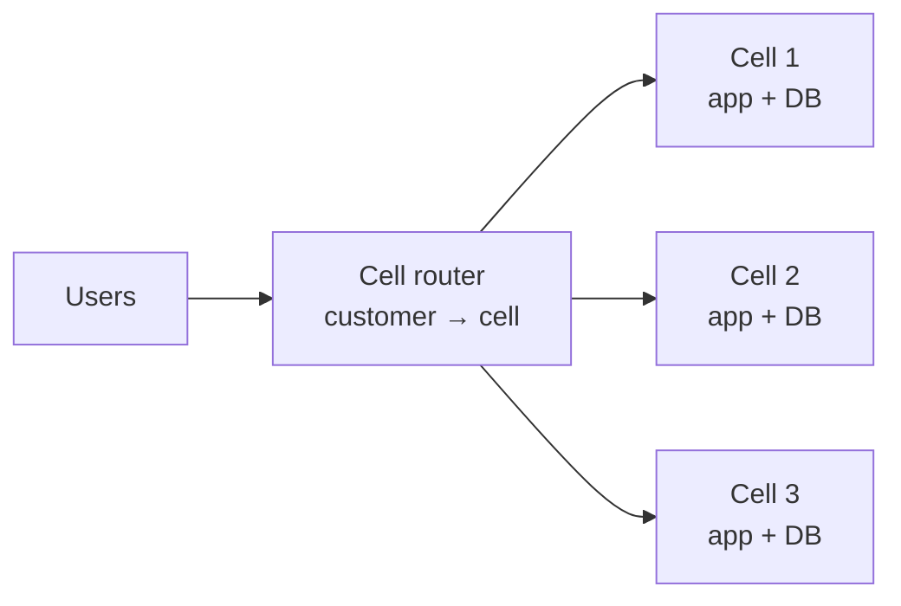

# Reliability 3: High Availability — Zones, Regions & Failover

> **In one sentence:** high availability means designing so that any single failure — a server, a data center, or an entire region — doesn't take your service down, by running redundant copies in independent failure domains and shifting traffic automatically.

**Level:** Advanced · **You'll learn:** failure domains, multi-AZ vs multi-region, traffic failover, replicating data across regions, active-passive vs active-active, and cell-based architecture.

## See it in action

<em>Interactive animation available on the website.</em>

## Failure domains

| Level | What can fail together | Protection |
|-------|------------------------|------------|
| Process / container | One crash | Multiple replicas + health checks (Kubernetes does this) |
| Node / server | Hardware failure, kernel panic | Spread replicas across nodes (anti-affinity) |
| Rack | Top-of-rack switch, power strip | Spread across racks |
| **Availability Zone (AZ)** | One data center building: power, cooling, flooding | **Multi-AZ by default** for anything production |
| **Region** | Natural disaster, major provider incident, regional network issue | Multi-region for critical systems |
| Provider | Global control-plane bug, account issues | Multi-cloud (rarely worth it — very expensive) |

AZs in a region are miles apart with independent power and networking but low latency between them (~1–2 ms) — **synchronous replication across AZs is practical**. Regions are hundreds or thousands of km apart (tens of ms) — cross-region replication is usually **asynchronous**.

## Multi-AZ: the default

- Load balancer spanning ≥ 3 AZs; app replicas spread with `topologySpreadConstraints` (see [Production readiness](09-kubernetes-production-readiness.md)).
- Databases with synchronous standby in another AZ (e.g., RDS Multi-AZ) and automatic failover in ~1–2 minutes.
- Zonal storage (block volumes) doesn't move between AZs → keep data in replicated databases/object storage, not on one node's disk.
- Plan capacity so losing one AZ (a third of capacity) still handles peak — **N+1 at the zone level**.

## Multi-region: active-passive vs active-active

| | Active-passive (failover) | Active-active |
|---|---|---|
| Traffic | One region serves; the other waits (warm standby / pilot light) | All regions serve users (often nearest region) |
| Data | Async replication primary → secondary | Writes in multiple regions: partitioned ownership or conflict resolution |
| Failover | Promote standby; shift traffic (minutes) | Drain the failed region (seconds) |
| Complexity | Moderate | High |
| Bonus | — | Lower latency for global users |

### The hard part: data

1. **Single-writer with async replicas:** simple; on failover you may lose the replication lag (RPO = seconds of writes).
2. **Partition by home region:** each user/tenant/conversation has one home region that owns writes (like the [chat system](../classic-system-design/04-chat-system.md)); other regions read replicas or forward writes. Failover reassigns homes.
3. **Multi-writer databases:** globally distributed SQL (Spanner, CockroachDB, Aurora DSQL-style systems) using consensus across regions — strong consistency at the cost of cross-region write latency; or multi-master with conflict resolution (DynamoDB global tables: last-writer-wins).
4. **Stateless + caches:** caches can be rebuilt per region; sessions should live in a replicated store or be re-creatable.

### Traffic management

| Mechanism | How | Failover speed |
|-----------|-----|----------------|
| DNS failover (health-checked) | Return the healthy region's address | Detection (~30 s) + TTL (60 s) + clients that ignore TTL |
| Global anycast load balancer | One IP announced worldwide; routes to healthy backends | Seconds |
| Client-side retries to a secondary endpoint | Mobile apps/SDKs know both regions | Immediate, but needs client support |

The [Terraform example](examples/reliability/terraform/dns-failover.tf) creates a Route 53 health check on `/healthz` and PRIMARY/SECONDARY failover records.

## Cell-based architecture (limit the blast radius)

Instead of one giant deployment, run many independent **cells** (full stacks serving a subset of customers), with a thin routing layer mapping customers to cells. A bad deploy, overload, or poison-pill request affects one cell, not everyone. Large SaaS providers use cells within and across regions.

## Availability math

- Serial dependencies multiply: three services at 99.9% each → 0.999³ ≈ **99.7%**.
- Redundant copies combine: two independent 99% regions → 1 − 0.01² = **99.99%** (only if failures are truly independent and failover works!).
- Your availability can't exceed that of your critical dependencies (DNS, identity provider, payment provider) — find and harden them.

## Common mistakes

- "Multi-region" but the control plane (CI/CD, secrets, container registry, DNS management) lives only in the primary region.
- Never actually failing over → the first real failover breaks on something forgotten.
- DR region quota too low to absorb full load.
- Health checks that only check "process is up", not "can serve requests".
- Retries from all clients at once overwhelming the surviving region — use jittered backoff and load shedding.

## Quick check

**Q: Why is synchronous replication common across AZs but rare across regions?**

A: AZ-to-AZ latency is ~1–2 ms, so waiting for a synchronous acknowledgment barely slows writes. Cross-region latency is tens to hundreds of ms per write, which most applications can't afford.

**Q: Your DNS failover TTL is 60 seconds, yet some users still hit the dead region for 10 minutes. Why?**

A: Some resolvers and clients cache longer than the TTL or keep connections open. Mitigate with client-side retry to a secondary endpoint, anycast global load balancing, and closing long-lived connections from the failed region.

**Next:** [Infrastructure as Code with Terraform](18-infrastructure-as-code-terraform.md)
