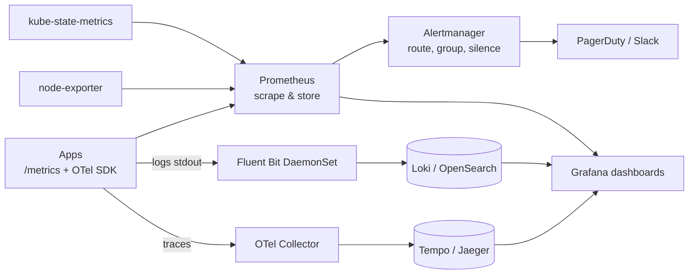

# Reliability 5: Observability, SLOs & Alerting

> **In one sentence:** observability means you can understand what your system is doing from the outside — through **metrics, logs, and traces** — and alerting means the right human is woken up only when users are actually being hurt.

**Level:** Intermediate → Advanced · **You'll learn:** the three pillars, what to measure (golden signals, RED, USE), SLIs/SLOs/error budgets, burn-rate alerts, the Kubernetes monitoring stack, and alert hygiene.

## See it in action

<div class="sim" data-sim="pipeline" data-title="From a symptom to a root cause" data-steps="Alert fires|Dashboard|Traces|Logs|Root cause|Fix & verify" data-labels="Error-budget burn rate too high for checkout|Errors spiked at 14:02 after deploy v1.8|Slow spans in payment-service → DB|'connection pool exhausted' errors|New release halved the DB pool size|Roll back; error rate returns to baseline"><em>Interactive animation available on the website.</em></div>

## The three pillars

| Signal | What it is | Good for | Tools |
|--------|------------|----------|-------|
| **Metrics** | Numbers over time (counters, gauges, histograms) | Dashboards, alerts, trends; cheap to store | Prometheus, Grafana, Datadog, CloudWatch |
| **Logs** | Timestamped events, ideally structured JSON | Details of what happened to one request | Loki, Elasticsearch/OpenSearch, Cloud Logging |
| **Traces** | A request's path through services, with timing per span | Finding *where* latency/errors come from | OpenTelemetry + Jaeger/Tempo/Zipkin |

Tie them together with a **trace ID** in every log line and metric exemplars, so you can jump from an alert → dashboard → trace → logs. **OpenTelemetry** is the vendor-neutral standard for instrumenting all three.

## What to measure

- **Four golden signals** (for user-facing services): **latency**, **traffic**, **errors**, **saturation**.
- **RED** (per service/endpoint): **R**ate, **E**rrors, **D**uration.
- **USE** (per resource — CPU, disk, pools): **U**tilization, **S**aturation, **E**rrors.
- **Business metrics:** orders/minute, sign-ups, payments succeeded — often the fastest signal that something is wrong.

Use **histograms** for latency so you can compute p50/p95/p99 across instances (averages hide pain; you can't average percentiles).

## SLIs, SLOs and error budgets

| Term | Example |
|------|---------|
| **SLI** (indicator) | % of HTTP requests that succeed in < 300 ms |
| **SLO** (objective) | 99.9% of requests good over 30 days |
| **Error budget** | 0.1% of requests may fail ≈ **43 minutes** of full outage per month |
| **SLA** (agreement) | Contract with customers, with penalties — set looser than the SLO |

The error budget turns reliability into a decision tool: budget left → ship faster; budget burned → freeze risky launches and invest in reliability.

## Alert on symptoms with burn rates

Alert when users are affected, not on every CPU spike. **Burn-rate alerts** compare how fast you're consuming the error budget against the SLO:

| Window | Burn rate | Meaning | Action |
|--------|-----------|---------|--------|
| 1 h (with 5 min confirm) | 14.4× | 2% of the monthly budget gone in an hour | **Page** |
| 6 h (with 30 min confirm) | 6× | 5% in 6 hours | Page |
| 3 days | 1× | On track to exactly exhaust the budget | Ticket |

From the [example PrometheusRule](examples/reliability/k8s/prometheus-rules.yaml) (validated against the Prometheus Operator CRD schema):

```yaml
- alert: NotesApiHighErrorBudgetBurn
  expr: |
    (
      sum(rate(http_requests_total{job="notes-api",code=~"5.."}[5m]))
      / sum(rate(http_requests_total{job="notes-api"}[5m]))
    ) > (14.4 * 0.001)
  for: 2m
  labels:
    severity: page
  annotations:
    summary: "notes-api is burning its error budget fast"
    runbook_url: "https://…/20-incident-response-and-postmortems.md"
```

Also alert on things that silently break recovery: **missing backups**, certificate expiry, replication lag, DR region capacity.

## The Kubernetes monitoring stack



Install with the **kube-prometheus-stack** Helm chart; define alerts as `PrometheusRule` objects in git (GitOps) and dashboards as code. For long retention and multiple clusters: Thanos, Cortex/Mimir, or a managed service.

Monitor the monitoring: a **dead man's switch** alert that always fires — if it stops arriving, your alerting pipeline is broken. Keep observability for the DR region independent of the primary region.

## Alert hygiene

- Every page must be **actionable** and link a **runbook**.
- Page for user impact; ticket for slow-burn issues; dashboard for everything else.
- Group related alerts (one page for 50 pods), set `for:` durations to avoid flapping, inhibit downstream alerts when an upstream dependency is down.
- Review alerts after every on-call shift: delete or fix noisy ones. Alert fatigue causes real incidents to be missed.

## Quick check

**Q: CPU on one node is at 95%. Should that page someone at 3 a.m.?**

A: Usually not — it's a cause, not a symptom. Page only if users are affected (error-rate or latency SLO burn). Track saturation on dashboards and tickets.

**Q: Your SLO is 99.9% monthly and you've had a 30-minute outage. How much error budget is left?**

A: The budget is ~43 minutes/month; 30 are spent, ~13 minutes remain — time to slow risky releases.

**Next:** [Incident response & postmortems](20-incident-response-and-postmortems.md)
