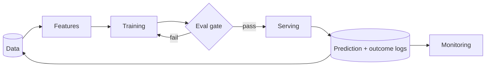

# The ML System Lifecycle

> **In one sentence:** a production ML system is a loop — collect data, train a model, evaluate it, deploy it, monitor it, and feed what you learn back into the data.

## Everyday analogy

A chef perfecting a recipe: gather ingredients (data), cook a version (train), taste it (evaluate), serve it to customers (deploy), watch their reactions (monitor), and adjust the recipe (retrain). A great recipe from last year can go stale when customers' tastes change (drift).

## See it in action

<em>Interactive animation available on the website.</em>

## Step by step

| Step | Key questions | Typical pitfalls |
|------|---------------|------------------|
| **1. Frame the problem** | What decision does the model drive? What's the success metric (business + ML)? Is ML even needed? | Optimizing clicks when you care about long-term satisfaction |
| **2. Data** | Where do labels come from? How much? How fresh? Any bias? | Label leakage (using information from the future) |
| **3. Features** | What signals predict the target? Can they be computed at serving time? | Training–serving skew |
| **4. Model** | Start simple (logistic regression / GBDT), then deep models if justified | Jumping to a giant model before a baseline |
| **5. Evaluation** | Offline metrics, per-segment slices, compare to baseline | Good average, terrible for a minority segment |
| **6. Deployment** | Online (real time) vs batch? Latency budget? Shadow mode, canary, A/B | Offline gains that don't show up online |
| **7. Monitoring** | Data drift, prediction drift, performance with delayed labels, latency/cost | Silent decay nobody notices |

## Interview framing template for any AI problem

1. **Clarify the goal** → turn it into an ML task (classification, ranking, generation, retrieval).
2. **Data & labels** → sources, labeling strategy, imbalance.
3. **Features / inputs** → user, item, context; real-time vs batch.
4. **Model** → baseline first, then a stronger model; justify with latency and data size.
5. **Serving** → architecture, latency budget, caching, fallbacks.
6. **Evaluation** → offline metrics + online A/B tests + guardrail metrics.
7. **Monitoring & iteration** → drift, feedback loops, retraining cadence.

## Online vs batch prediction

| | Online | Batch |
|---|---|---|
| When | Per request, real time | Precomputed on a schedule |
| Latency need | Milliseconds | Hours OK |
| Example | Fraud scoring, search ranking | Nightly churn scores, weekly emails |
| Cost | Always-on serving | Cheaper, but stale |

## Where it shows up

[ML Platform](../../ai-system-design/09-ml-platform.md), [Fraud Detection](../../ai-system-design/08-fraud-detection.md), [Recommendation System](../../ai-system-design/03-recommendation-system.md).

## Quick check

**Q: Your model's offline AUC improved but the A/B test shows no gain. Name two possible reasons.**

A: Training–serving skew (features differ online), or the offline metric doesn't reflect the business objective (e.g., AUC improved on items users never see).

**Q: What is "label leakage"?**

A: Training with information that wouldn't be available at prediction time (e.g., a "refund issued" feature when predicting fraud) — the model looks great offline and fails in production.
