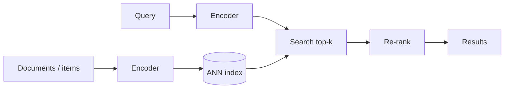

# Embeddings & Vector Search

> **In one sentence:** an embedding turns text, images, or users into a list of numbers so that similar things end up close together — and vector search finds the closest ones quickly.

## Everyday analogy

Imagine a giant map where every song is a pin. Calm piano songs cluster in one corner, heavy metal in another. "Find songs like this one" becomes "find the nearest pins on the map". Embeddings build the map; vector search finds the nearby pins.

## See it in action

<div class="sim" data-sim="vector-search"><em>Interactive animation available on the website.</em></div>

Click anywhere to drop a query. The nearest points (by distance) light up — those are the search results. Points of the same color are similar topics.

## How embeddings work

- A neural network (an **encoder**) maps an input to a vector, e.g., 768 numbers.
- It's trained so that related pairs (a question and its answer, a query and a clicked product, an image and its caption) get **similar vectors** and unrelated pairs get different ones (**contrastive learning**).
- Similarity is measured by **cosine similarity** or **dot product** (or Euclidean distance).

```
"How do I reset my password?"   → [0.12, -0.40, 0.88, ...]
"Forgot my login credentials"   → [0.10, -0.38, 0.91, ...]   ← close
"Best pizza in Chicago"         → [-0.70, 0.22, 0.05, ...]   ← far
```

### Why not keyword search?

Keyword search matches words; embeddings match **meaning**. "Car won't start" finds "vehicle battery dead". But keywords win on exact terms (error codes, product IDs) — so real systems use **hybrid search** (both, combined).

## How vector search scales

Comparing a query to 1 billion vectors one by one is too slow. **Approximate Nearest Neighbor (ANN)** indexes trade a tiny bit of accuracy for huge speedups:

| Index | Idea | Trade-off |
|-------|------|-----------|
| **HNSW** | A layered graph; hop greedily toward the query | Fast and accurate; uses lots of memory |
| **IVF** | Cluster vectors; search only the closest clusters | Smaller; recall depends on clusters probed |
| **PQ (product quantization)** | Compress vectors to a few bytes | 10–50× less memory; less precise → re-rank top results |

Quality metric: **recall@k** — what fraction of the true top-k neighbors the ANN index returns (aim for 95%+).



## Common mistakes

- Using a different embedding model for queries and documents (vectors live in different spaces).
- Changing the embedding model without re-embedding the whole corpus.
- Ignoring metadata filters (price, permissions) — vector search alone can't enforce them.

## Where it shows up

[Semantic Search / Vector DB](../../ai-system-design/06-semantic-search-vector-db.md), [RAG Assistant](../../ai-system-design/01-rag-enterprise-assistant.md), [Recommendation System](../../ai-system-design/03-recommendation-system.md) (two-tower retrieval).

## Quick check

**Q: Why is ANN "approximate" acceptable for search?**

A: Missing a few of the true nearest neighbors barely changes result quality, but the index makes search 100–1000× faster — and a re-ranker fixes the final order anyway.

**Q: A user searches for error code "E1043" and gets irrelevant results. Why, and how do you fix it?**

A: Embeddings capture meaning, not exact rare tokens. Add keyword (BM25) search and fuse the results (hybrid search).
