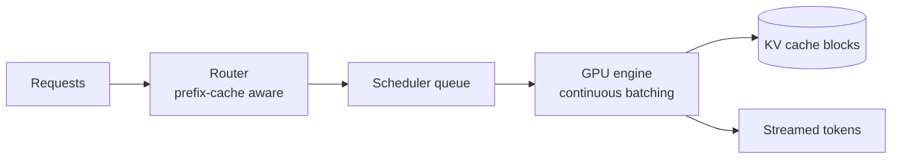

# LLM Serving & Batching

> **In one sentence:** GPUs are expensive, so LLM servers pack many users' requests into the same GPU work, and continuous batching keeps the GPU full by swapping finished requests out and new ones in at every step.

## Everyday analogy

A bus (the GPU) that only leaves when every passenger reaches the final stop wastes seats — people who got off early leave empty seats for the rest of the ride (**static batching**). A city bus that picks up new passengers at every stop keeps seats full (**continuous batching**).

## See it in action

<em>Interactive animation available on the website.</em>

Each row is a GPU slot; each bar is a request generating tokens. Compare **static** (wait for the longest request) with **continuous** (refill a slot immediately). Watch the throughput counter.

## Why batching works

During decode, each step reads all model weights from memory (e.g., 140 GB for a 70B FP16 model). Reading them once and applying them to 64 sequences costs barely more than for 1 sequence → **throughput scales almost linearly with batch size** until compute becomes the limit.

## Key serving techniques

| Technique | What it does | Win |
|-----------|--------------|-----|
| **Continuous batching** | Add/remove requests at every decode step | 5–20× throughput vs static |
| **PagedAttention** | Store KV cache in small blocks, like OS memory pages | Little wasted memory → more concurrent users |
| **Prefix caching** | Reuse KV cache for shared prompt prefixes (system prompts, chat history) | Much lower TTFT and cost |
| **Quantization** (FP8/INT4) | Smaller weights | Fits on fewer GPUs, faster decode |
| **Tensor parallelism** | Split a model across GPUs | Serve models bigger than one GPU |
| **Speculative decoding** | Small model drafts tokens, big model verifies several at once | 2–3× faster at low load |
| **Chunked prefill** | Split long prompts into chunks interleaved with decode | Long prompts don't freeze others' streams |

## The core trade-off: latency vs throughput

- Bigger batches → more tokens/second per GPU (cheaper) but each user's tokens arrive slower.
- Interactive chat needs low latency; batch jobs (summarizing 1M documents) want max throughput.
- Real platforms run **priority classes** and set batch limits per class.

## Metrics to know

- **TTFT** — time to first token.
- **ITL / TPOT** — time between output tokens.
- **Throughput** — tokens/second per GPU.
- **Goodput** — requests/second that meet the latency SLO (what actually matters).

## Where it shows up

[LLM Inference Serving](../../ai-system-design/02-llm-inference-serving.md), [Conversational Assistant](../../ai-system-design/04-conversational-assistant.md), [AI Code Assistant](../../ai-system-design/11-ai-code-assistant.md).

## Quick check

**Q: Why does continuous batching beat static batching?**

A: In static batching, slots of finished short requests sit idle until the longest request ends. Continuous batching refills those slots immediately, keeping the GPU busy.

**Q: Your chat product's system prompt is 3,000 tokens and identical for every user. What optimization helps most?**

A: Prefix caching (with cache-aware routing): compute that prefix's KV cache once and reuse it, cutting TTFT and prefill cost for every request.
