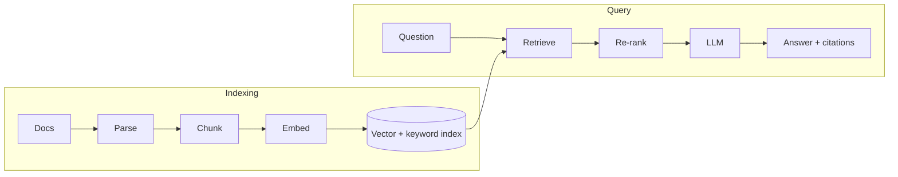

# Retrieval-Augmented Generation (RAG)

> **In one sentence:** RAG answers questions by first **searching** your documents for relevant passages and then asking an LLM to answer **using only those passages**, with citations.

## Everyday analogy

An open-book exam. Instead of answering from memory (which may be outdated or wrong), the student looks up the relevant pages in the textbook, then writes the answer and cites the page numbers.

## See it in action

<em>Interactive animation available on the website.</em>

## Why RAG?

| Problem with a plain LLM | How RAG fixes it |
|--------------------------|------------------|
| Doesn't know your private data | Retrieves it at question time |
| Knowledge is out of date | Index updates in minutes |
| Hallucinates confidently | Must answer from sources; can say "I don't know" |
| Can't show where an answer came from | Citations to source documents |
| Can't enforce who sees what | Retrieval filters by user permissions |

## The two pipelines

**Indexing (offline):** documents → parse/clean → split into **chunks** (~300–800 tokens) → embed each chunk → store in a vector index + keyword index, with metadata (source, date, permissions).

**Query (online):** question → (rewrite) → **hybrid retrieval** → **re-rank** → prompt with top chunks → LLM → answer + citations.

## What makes RAG good (or bad)

1. **Parsing & chunking quality** — tables broken in half or chunks without context ("it increased 5%") ruin retrieval. Keep sections together; add the doc title/heading to each chunk.
2. **Retrieval** — hybrid (vectors + keywords) beats either alone; re-rankers add a big precision boost.
3. **Prompting** — clear instructions to use only the sources, cite them, and abstain when unsure.
4. **Evaluation** — separate retrieval quality (did we find the right chunk?) from generation quality (did the LLM use it faithfully?).

## RAG vs fine-tuning

| | RAG | Fine-tuning |
|---|---|---|
| Teaches | Facts / knowledge | Style, format, behavior, domain language |
| Freshness | Update the index anytime | Retrain to update |
| Citations & permissions | Yes | No |
| Use when | Answers depend on documents | Need a consistent behavior or skill |

They combine well: fine-tune for style/format, RAG for facts.

## Where it shows up

[RAG Enterprise Assistant](../../ai-system-design/01-rag-enterprise-assistant.md), [Conversational Assistant](../../ai-system-design/04-conversational-assistant.md) (file uploads), [AI Code Assistant](../../ai-system-design/11-ai-code-assistant.md) (code RAG).

## Quick check

**Q: Users get wrong answers. How do you tell whether retrieval or generation is at fault?**

A: Look at the trace: if the correct chunk wasn't retrieved, it's a retrieval problem (chunking, embeddings, query rewriting); if it was retrieved but the answer is still wrong, it's a generation/prompt problem.

**Q: Why filter by permissions before the LLM rather than after?**

A: Anything placed in the prompt can leak into the answer. Unauthorized content must never reach the model.
