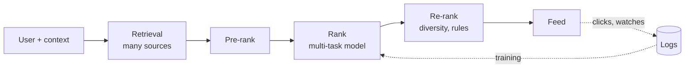

# The Recommendation Funnel (Retrieval → Ranking → Re-ranking)

> **In one sentence:** you can't score a billion items for every user in 200 ms, so recommenders narrow the candidates in stages — cheap models on many items first, expensive models on a few items last.

## Everyday analogy

Hiring: thousands of résumés → a quick keyword screen leaves 200 → a recruiter call leaves 20 → full interviews pick 3. Each stage is more careful and more expensive, applied to fewer candidates.

## See it in action

<div class="sim" data-sim="funnel"><em>Interactive animation available on the website.</em></div>

## The stages

| Stage | Items in → out | Model | Latency |
|-------|----------------|-------|---------|
| **Candidate retrieval** | 1B → ~5,000 | Two-tower embeddings + ANN, "similar to what you watched", followed creators, trending | ~30 ms |
| **Pre-ranking** | 5,000 → 500 | Small, fast model | ~20 ms |
| **Ranking** | 500 → 100 | Large model predicting click, watch time, like, share, skip | ~60 ms |
| **Re-ranking / policy** | 100 → 20 | Rules: diversity, freshness, no repeats, safety filters | ~10 ms |

### Two-tower retrieval in 3 lines
- A **user tower** turns user history into a vector; an **item tower** turns each item into a vector.
- Trained so the dot product is high for items the user engaged with.
- Item vectors are precomputed and indexed → at request time, compute the user vector and run vector search. See [Embeddings & Vector Search](02-embeddings-and-vector-search.md).

### The ranking score
The ranker predicts several outcomes and combines them, e.g.:
```
score = 0.5·P(watch > 30s) + 0.2·P(like) + 0.3·P(share) − 1.0·P("not interested")
```
The weights encode what the business values — tuned with A/B tests on long-term metrics (retention, satisfaction), not just clicks.



## Classic challenges

- **Cold start:** new users (use popular/onboarding signals) and new items (use content embeddings + exploration).
- **Feedback loops:** the model only learns about what it shows → reserve some traffic for exploration.
- **Position bias:** top items get clicked more regardless of quality → model position during training.
- **Optimizing the wrong thing:** pure click optimization → clickbait.

## Where it shows up

[Recommendation System](../../ai-system-design/03-recommendation-system.md), [News Feed](../../classic-system-design/03-news-feed.md), [Ad Click Prediction](../../ai-system-design/13-ad-click-prediction.md).

## Quick check

**Q: Why not just use the big ranking model on all items?**

A: Scoring 1B items × 100k requests/second is computationally impossible within 200 ms. The funnel spends expensive compute only where it matters.

**Q: Retrieval missed a great video. Can the ranker fix it?**

A: No — the ranker only sees what retrieval returns. Retrieval recall caps the quality of the whole system.
