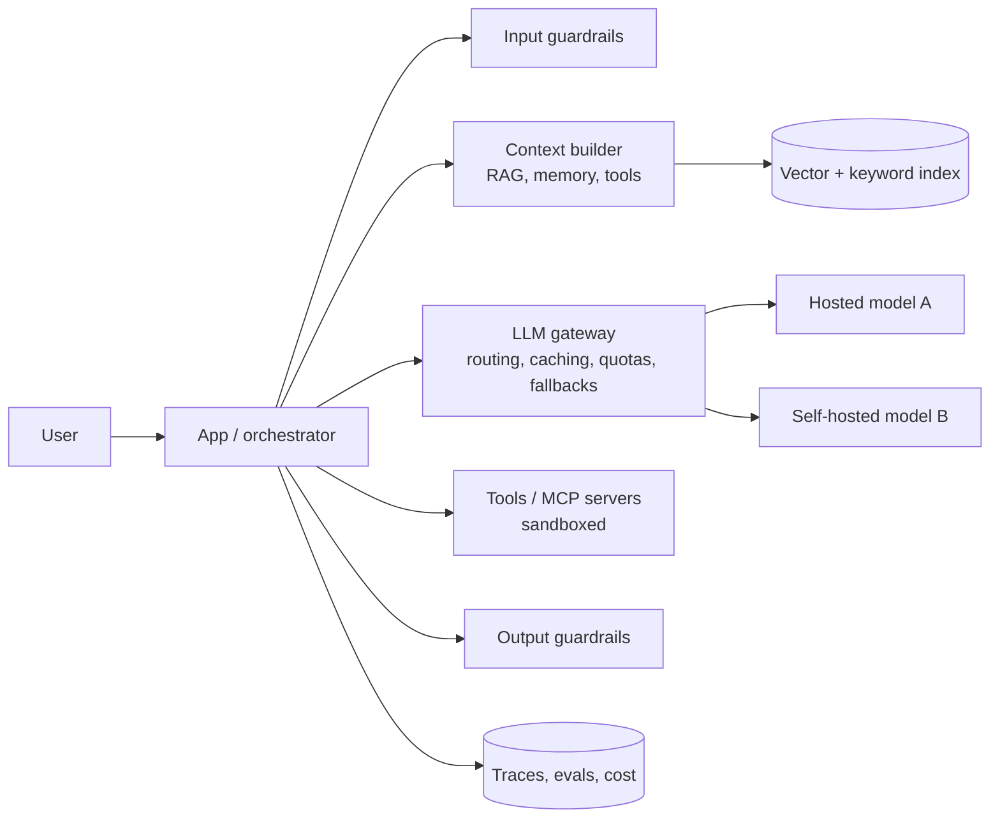

# How GenAI Changes System Design

> **In one sentence:** when a large language model sits in the request path, the unit of cost becomes the **token**, latency is measured in **time to first token**, outputs are **probabilistic**, and correctness is proven with **evals** instead of only unit tests — so classic design habits need updating.

## Everyday analogy

Classic software is a vending machine: press B4, always get the same snack in a second, cost known in advance. A GenAI feature is a talented but unpredictable chef: you describe what you want, the result is usually great but varies, longer orders take longer and cost more, and you need a taster (evals and guardrails) before food leaves the kitchen.

## Try it: LLM cost & capacity calculator

<em>Interactive calculator available on the website.</em>

Prices are adjustable placeholders — plug in your provider's current rates. Notice how output tokens and cache hit rate dominate the bill.

## What changes, side by side

| Concern | Classic system | GenAI system |
|---------|----------------|--------------|
| **Unit of cost** | Requests, CPU-seconds, storage | **Tokens in and out**; output tokens often cost 3–5× input |
| **Latency** | ~10–200 ms, mostly fixed | **TTFT + tokens × time-per-token**; seconds; stream to hide it |
| **Determinism** | Same input → same output | Same input → *different* outputs; temperature, model versions |
| **Correctness** | Unit/integration tests | **Evals**: graded datasets, LLM-as-judge, human review, online metrics |
| **Capacity** | Add CPU servers in seconds | **GPU-bound**, scarce, slow to start; rate limits from providers |
| **Caching** | Exact key → value | Exact prompt cache, **prefix (KV) caching**, **semantic caching** by meaning |
| **Failure modes** | Errors, timeouts | Plus hallucinations, refusals, prompt injection, unsafe output, cost blowups |
| **"Code"** | Source code | Source code **+ prompts + model version + retrieval config + tool definitions** — all versioned |
| **Security boundary** | Validate user input | **All text the model reads is untrusted** (documents, web pages, tool results) |
| **Data** | Stored and queried | Also **context**: what you put in the window decides quality (context engineering) |

## The new building blocks

- **LLM gateway:** one place for provider keys, routing, fallbacks, caching, quotas, and cost tracking → [problem 17](../../ai-system-design/17-llm-gateway.md).
- **Retrieval (RAG):** ground answers in your data → [RAG explained](05-rag-explained.md).
- **Tools & agents:** the model takes actions → [AI agents](07-ai-agents-explained.md), [MCP platform](../../ai-system-design/22-mcp-tool-platform.md).
- **Guardrails & evals:** measure and constrain behavior → [Evaluation & Guardrails](../../ai-system-design/10-llm-evaluation-guardrails.md).
- **Observability:** trace every prompt, tool call, token, and dollar.

## New design principles

1. **Use the simplest thing that works:** a single well-prompted call → a fixed workflow → an agent. Each step up adds cost, latency, and unpredictability.
2. **Design for streaming** from the start (SSE/WebSockets, resumable streams).
3. **Budget tokens like memory:** cap context and output sizes; summarize; retrieve instead of stuffing.
4. **Route by difficulty:** small, cheap models for easy requests; large models only when needed.
5. **Cache aggressively and safely:** stable prompt prefixes first (prefix caching), semantic caches keyed by meaning *and* permissions.
6. **Make outputs checkable:** structured outputs (JSON schemas), citations, tests for generated code.
7. **Evals are your test suite:** every prompt/model change runs an eval set in CI; monitor quality online.
8. **Treat model text as untrusted:** authorization lives in code, not prompts; least-privilege tools; human approval for risky actions.
9. **Plan for model churn:** models change every few months — abstract providers, pin versions, re-run evals before upgrading.
10. **Keep humans in the loop** where mistakes are expensive (money, health, legal, irreversible actions).

## How to answer a GenAI design question in an interview

1. Clarify the task, users, quality bar, latency budget, and **cost per request** budget.
2. Decide: prompt-only, RAG, fine-tuning, or agent? Justify.
3. Sketch the pipeline: input guardrails → context building → model call(s) → tools → output checks → response.
4. Estimate tokens, cost, and GPU/provider capacity (use the calculator above).
5. Deep dive on the hard parts: retrieval quality, agent safety, latency, evaluation.
6. Explain evaluation (offline + online) and failure handling (fallback models, graceful degradation, human escalation).

## Quick check

**Q: Your chatbot's monthly bill doubled after a release, with the same traffic. Where do you look first?**

A: Token usage per request: a longer system prompt, more retrieved chunks, longer conversation history, more agent steps, or longer outputs — and whether prefix/semantic cache hit rates dropped.

**Q: Why aren't unit tests enough for an LLM feature?**

A: Outputs vary run to run and "correct" is often fuzzy. You need eval datasets with graders (code checks, LLM judges calibrated against humans) and statistics over many samples, plus online monitoring.
