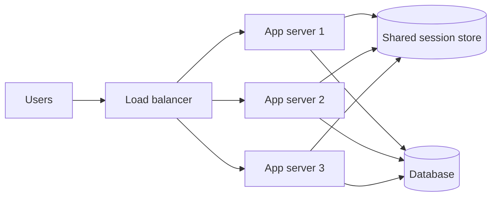

# Scalability Basics: Vertical vs Horizontal Scaling

> **In one sentence:** scalability is the ability to handle more users by adding resources — either a bigger machine (vertical) or more machines (horizontal).

## Everyday analogy

A coffee shop gets busy. It can hire a **faster barista** (vertical scaling) — but there's a limit to how fast one person can work. Or it can **add more baristas and counters** (horizontal scaling) — almost unlimited, but now they need to coordinate who serves whom.

## See it in action

<em>Interactive animation available on the website.</em>

Click **Add server** and watch the load on each server drop. That's horizontal scaling.

## How it works

| | Vertical scaling (scale up) | Horizontal scaling (scale out) |
|---|---|---|
| What you do | Bigger CPU, more RAM, faster disk | Add more machines behind a load balancer |
| Limit | Hardware ceiling (and price grows steeply) | Practically unlimited |
| Failure | One machine = single point of failure | One machine dies, others keep serving |
| Complexity | Simple — no code changes | Needs stateless services, load balancing, data partitioning |

### The key trick: make servers stateless

A server is **stateless** if it doesn't remember anything about the user between requests. Session data, uploaded files, and caches live in shared stores (Redis, a database, object storage). Then any server can handle any request — and you can add or remove servers freely.

### Where scaling gets hard

Stateless app servers are easy to scale. **State** is the hard part:
1. **Databases** — scale reads with [replication](05-replication.md), scale writes with [sharding](06-sharding-and-consistent-hashing.md).
2. **Caches** — distributed across nodes with consistent hashing.
3. **Coordination** — anything needing a single global order or lock becomes a bottleneck.

## Key numbers to remember

- 1 million requests/day ≈ **12 requests/second**
- A simple web server handles **~1k–10k requests/second**
- Peak traffic ≈ **2–3× average**

## Common mistakes

- Scaling out before measuring — find the actual bottleneck first (often the database).
- Storing sessions in server memory, then wondering why users get logged out when traffic shifts.
- Forgetting that more servers = more connections to the database.

## Where it shows up

Every problem in this repo. See [URL Shortener](../../classic-system-design/01-url-shortener.md) for a read-heavy scale-out example.

## Quick check

**Q: Why is horizontal scaling usually preferred for web servers?**

A: It has no hard ceiling, removes the single point of failure, and lets you add capacity gradually — as long as servers are stateless.

**Q: When is vertical scaling the right choice?**

A: Early on, or for components that are hard to distribute (a relational database primary). A bigger machine is often the cheapest fix until you hit its limit.
