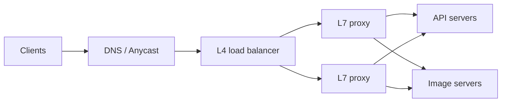

# Load Balancing

> **In one sentence:** a load balancer sits in front of many servers and spreads incoming requests across them, skipping servers that are unhealthy.

## Everyday analogy

The host at a busy restaurant seats each new group at a different waiter's section, so no waiter is overwhelmed — and if a waiter goes home sick, the host stops seating people there.

## See it in action

<em>Interactive animation available on the website.</em>

Switch the algorithm and click a server to make it fail. The load balancer stops sending it traffic.

## How it works

1. Clients connect to one address (the load balancer).
2. The LB picks a healthy backend using an algorithm.
3. It runs **health checks** (e.g., `GET /health` every 5 s) and removes failing servers.

### Algorithms

| Algorithm | How it picks | Good for |
|-----------|--------------|----------|
| Round robin | Next server in order | Identical servers, similar requests |
| Weighted round robin | Bigger servers get more | Mixed hardware |
| Least connections | Server with fewest active requests | Requests of very different duration |
| Consistent hashing on a key | Same user/key → same server | Caches, sticky sessions, stateful services |
| Power of two choices | Pick 2 random, choose less loaded | Huge fleets, cheap and nearly optimal |

### Layer 4 vs Layer 7

- **L4 (transport):** routes TCP/UDP connections by IP/port. Very fast, doesn't look inside requests.
- **L7 (application):** understands HTTP — can route `/api/*` and `/images/*` differently, terminate TLS, add headers, do retries.

## Avoiding a single point of failure

The LB itself must be redundant: run multiple LBs (active-active), with DNS or anycast spreading traffic across them, or use a managed cloud LB.

## Common mistakes

- No health checks → users routed to dead servers.
- Sticky sessions everywhere → uneven load and painful deploys. Prefer stateless servers.
- Retrying failed requests on every layer → retry storms that amplify an outage.

## Where it shows up

[Rate Limiter](../../classic-system-design/02-rate-limiter.md) (runs in the gateway), [Chat System](../../classic-system-design/04-chat-system.md) (long-lived WebSocket connections need L4 balancing).

## Quick check

**Q: Requests vary from 5 ms to 5 s. Which algorithm?**

A: Least connections (or power of two choices) — round robin would pile long requests onto unlucky servers.

**Q: Why use consistent hashing in a load balancer?**

A: So the same key always reaches the same server (good cache hit rates), and adding/removing a server only moves a small fraction of keys.
