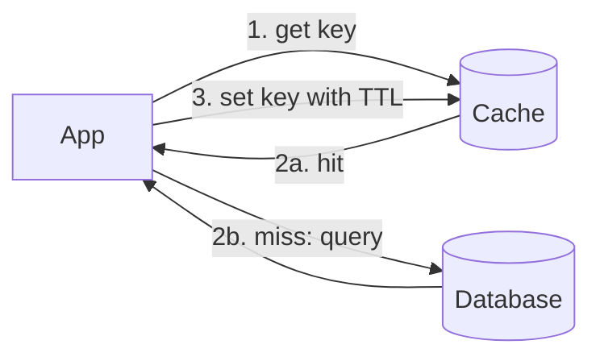

# Caching

> **In one sentence:** a cache keeps a copy of frequently used data in fast storage (memory) so you don't have to fetch it from slow storage (database, disk, network) every time.

## Everyday analogy

You keep your most-used spices on the counter instead of walking to the pantry every time. The counter is small, so you keep only what you use most — and occasionally a spice on the counter is older than the one in the pantry.

## See it in action

<em>Interactive animation available on the website.</em>

Green requests are **cache hits** (fast). Orange ones are **misses** that go to the database (slow) and then fill the cache. Watch the hit rate climb as the cache warms up.

## How it works

Memory reads take ~100 ns; a database query takes ~1–10 ms — **10,000× slower**. Because traffic is usually skewed (20% of items get 80% of requests), a small cache absorbs most of the load.

### Caching patterns

| Pattern | Read path | Write path | Trade-off |
|---------|-----------|------------|-----------|
| **Cache-aside** (most common) | App checks cache → on miss reads DB and fills cache | App writes DB, then deletes cache key | Simple; first read after a miss is slow |
| Read-through | Cache library loads from DB on miss | — | Cleaner app code |
| Write-through | — | Write cache and DB together | Cache always fresh; slower writes |
| Write-back | — | Write cache, flush to DB later | Fast writes; data loss risk |

### Eviction: what to throw out when full

- **LRU** (least recently used) — the default choice.
- **LFU** (least frequently used) — better when popularity is stable.
- **TTL** (time to live) — expire entries after N seconds to bound staleness.

### Where caches live

Browser → CDN (edge) → load balancer/proxy → application memory → distributed cache (Redis/Memcached) → database buffer cache.

## The hard parts

- **Invalidation:** when data changes, the cache must be updated or deleted, or users see stale data. Delete-on-write + TTL is a robust default.
- **Cache stampede:** a hot key expires and 10,000 requests hit the DB at once. Fix: request coalescing (one request refills, others wait), or refresh slightly before expiry.
- **Cold start:** an empty cache after restart sends everything to the DB. Warm up gradually.

## Where it shows up

[URL Shortener](../../classic-system-design/01-url-shortener.md), [News Feed](../../classic-system-design/03-news-feed.md) (timeline cache), [Search Autocomplete](../../classic-system-design/10-search-autocomplete.md) (edge caching of prefixes).

## Quick check

**Q: Your cache hit rate is 95%. The DB handles 1,000 QPS max. How much total traffic can you serve?**

A: Only misses hit the DB: 5% of traffic ≤ 1,000 QPS → ~20,000 QPS total. Raising hit rate to 99% would allow ~100,000 QPS.

**Q: Why delete the cache key on write instead of updating it?**

A: Two concurrent writers can update the cache in the wrong order and leave a stale value. Deleting forces the next read to load the latest value from the DB.
