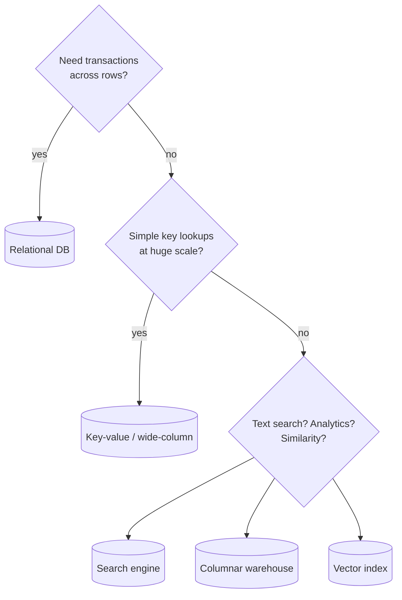

# Databases & Indexing: SQL vs NoSQL

> **In one sentence:** pick a database by its access patterns and consistency needs, and use indexes so queries jump straight to the data instead of scanning everything.

## Everyday analogy

A database without an index is a book without a table of contents — to find "caching" you read every page. An **index** is the alphabetical index at the back: look up the word, jump to the page.

## See it in action

<em>Interactive animation available on the website.</em>

A **full scan** checks rows one by one. An **index** (a sorted tree) finds the row in a few hops — about log₂(N) steps.

## How indexes work

- Most databases use a **B-tree**: a sorted, balanced tree. Finding one of 1 billion rows takes ~30 comparisons, and only 3–4 disk reads because each node holds hundreds of keys.
- Write-heavy stores (Cassandra, RocksDB) use **LSM trees**: writes go to memory and are flushed to sorted files — very fast writes, slightly slower reads.
- **Cost of indexes:** every write must update every index, and indexes take storage. Index the columns you filter and sort by — not everything.

## SQL vs NoSQL

| | Relational (PostgreSQL, MySQL) | Key-value / wide-column (DynamoDB, Cassandra) | Document (MongoDB) |
|---|---|---|---|
| Data shape | Tables with schemas, joins | Key → value / rows by partition key | JSON documents |
| Strength | Transactions (ACID), flexible queries, constraints | Massive scale, predictable latency, high writes | Flexible schema, nested data |
| Weakness | Harder to scale writes horizontally | Queries limited to designed access patterns; no joins | Joins and multi-doc transactions are limited |
| Use for | Payments, orders, inventory, users | Feeds, messages, sessions, metrics, IoT | Catalogs, content, profiles |

**ACID** = Atomicity (all or nothing), Consistency (rules hold), Isolation (concurrent transactions don't interfere), Durability (committed data survives crashes).

### How to choose in an interview

1. Do I need multi-row transactions or strong consistency (money, inventory)? → **Relational**.
2. Is the access pattern simple (lookup by key) at huge scale? → **Key-value / wide-column**.
3. Do I need full-text search? → add **Elasticsearch**. Analytics over billions of rows? → **columnar warehouse** (BigQuery, ClickHouse). Similarity search? → **vector index**.

Using more than one is normal ("polyglot persistence") — but each extra system adds operational cost.

## Common mistakes

- Choosing NoSQL "because it scales" when the data is relational and small.
- Missing an index on a foreign key or a frequently filtered column.
- Using `OFFSET 100000` for pagination — the DB still scans 100k rows. Use cursor-based pagination (`WHERE id > last_id`).

## Where it shows up

[Payment System](../../classic-system-design/12-payment-system.md) (ACID ledger), [Chat System](../../classic-system-design/04-chat-system.md) (Cassandra), [Ticket Booking](../../classic-system-design/14-ticket-booking.md) (row locks).

## Quick check

**Q: A table has 1 billion rows. Roughly how many comparisons does a B-tree lookup need?**

A: log₂(10⁹) ≈ 30 comparisons — versus up to a billion for a full scan.

**Q: Why not index every column?**

A: Each index slows every insert/update and uses storage; unused indexes are pure cost.
