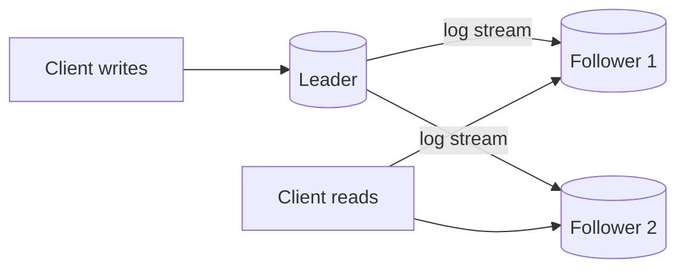

# Replication

> **In one sentence:** replication keeps copies of the same data on multiple machines so the system survives failures and can serve more reads.

## Everyday analogy

A teacher (the **leader**) writes notes on the board; students (**followers**) copy them into their notebooks. Anyone can read from a student's notebook — but a student who's slow at copying may be a few lines behind.

## See it in action

<em>Interactive animation available on the website.</em>

Writes go to the leader and flow to followers after a delay (**replication lag**). Reading from a lagging follower returns old data.

## How it works

### Leader–follower (primary–replica)
- All writes go to the leader; it streams changes (the write-ahead log) to followers.
- Reads can go to followers → read scaling.
- If the leader dies, a follower is **promoted** (failover).

### Synchronous vs asynchronous

| | Synchronous | Asynchronous |
|---|---|---|
| Write acknowledged when | Followers confirm too | Leader alone has it |
| Data loss on leader crash | None | Last few writes may be lost |
| Write latency | Higher | Lower |
| Common choice | One sync follower + rest async ("semi-sync") | Default in many setups |

### Other topologies
- **Multi-leader:** each region accepts writes; conflicts must be resolved. Good for multi-region writes, hard to get right.
- **Leaderless (Dynamo, Cassandra):** write to N replicas, succeed when W acknowledge; read from R. If **R + W > N**, reads overlap the latest write.

## Replication lag problems (and fixes)

- **Read-your-writes:** user updates their profile, refreshes, sees the old value (read hit a lagging follower). Fix: read your own recent writes from the leader.
- **Monotonic reads:** a user sees new data, then old data (two different followers). Fix: pin a user's reads to one replica.
- **Split brain:** two nodes both think they're leader. Fix: consensus (Raft/Paxos) and fencing tokens.

## Where it shows up

[Distributed KV Store](../../classic-system-design/06-distributed-key-value-store.md) (quorums), [Message Queue](../../classic-system-design/13-distributed-message-queue.md) (in-sync replicas).

## Quick check

**Q: N = 3 replicas, W = 2. What R gives you reads that always include the latest write?**

A: R ≥ 2, because R + W must exceed N (2 + 2 > 3).

**Q: Does replication help with write throughput?**

A: No — every replica must apply every write. Replication scales reads and availability; sharding scales writes.
