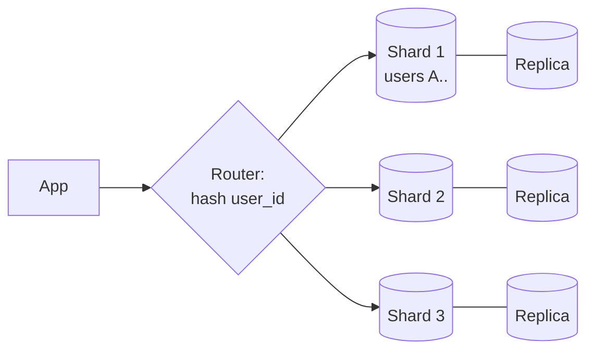

# Sharding & Consistent Hashing

> **In one sentence:** sharding splits data across many machines so each holds only a piece; consistent hashing decides which machine owns which piece while moving as little data as possible when machines are added or removed.

## Everyday analogy

A library too big for one building splits books across branches: A–F in branch 1, G–M in branch 2, and so on. Each branch handles only its own books. When a new branch opens, you'd rather move a few shelves than reshuffle every book in the city.

## See it in action

<em>Interactive animation available on the website.</em>

Keys (small dots) belong to the first server clockwise on the ring. **Add** or **remove** a server and only the keys in one arc move — highlighted in yellow.

## How sharding works

Pick a **shard key** (e.g., `user_id`) and a rule that maps each key to a shard:

| Strategy | Rule | Pros | Cons |
|----------|------|------|------|
| Range | `A–F → shard 1` | Range queries are easy | Hot spots (everyone named "S", or recent timestamps) |
| Hash mod N | `hash(key) % N` | Even spread | Changing N remaps **almost every key** |
| **Consistent hashing** | Key → first node clockwise on a hash ring | Adding a node moves only ~1/N of keys | Slightly more complex |
| Directory / lookup | A table says where each key lives | Fully flexible | The directory is another system to scale |

### Why `hash % N` breaks

With 4 shards, key 13 → shard 1. Add a 5th shard: 13 % 5 = 3. Nearly every key moves → a massive data migration and cache wipe. Consistent hashing avoids this.

### Virtual nodes

Each physical server gets ~100–256 positions on the ring. This evens out the arcs (no server gets a huge slice by bad luck) and spreads a failed server's load across many others.

## Choosing a shard key

- High cardinality and even distribution (`user_id`, not `country`).
- Matches your most common query, so most queries hit **one shard** (all of a user's messages live together).
- Avoid monotonically increasing keys with range sharding (all new writes go to the last shard).

## The costs of sharding

- Cross-shard queries and joins become scatter-gather (slow).
- Cross-shard transactions need two-phase commit or sagas.
- **Hot keys** (a celebrity) can overload one shard → split the key or cache it.
- Resharding is operationally heavy — plan for growth up front (many logical shards mapped onto fewer machines).

## Where it shows up

[Distributed KV Store](../../classic-system-design/06-distributed-key-value-store.md), [Chat System](../../classic-system-design/04-chat-system.md) (partition by conversation), [Web Crawler](../../classic-system-design/07-web-crawler.md) (partition by host).

## Quick check

**Q: You have 10 nodes on a consistent-hash ring and add an 11th. Roughly what fraction of keys move?**

A: About 1/11 (~9%) — only the keys in the new node's arcs. With `hash % N`, about 90% would move.

**Q: Why is `created_at` a bad shard key for range sharding?**

A: All new writes land on the shard holding the latest time range — one hot shard while others sit idle.
