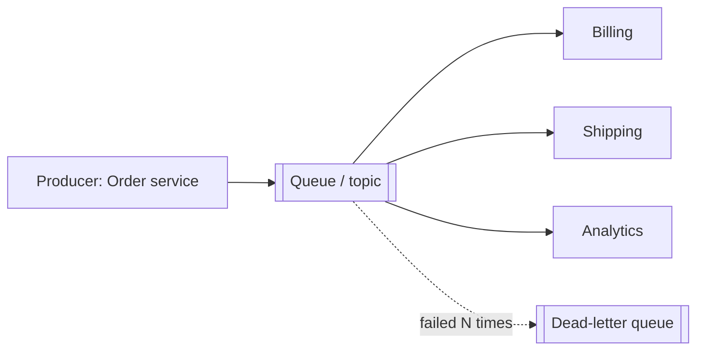

# Message Queues & Async Processing

> **In one sentence:** a message queue lets one service drop off work and continue immediately, while other services pick up that work at their own pace.

## Everyday analogy

At a restaurant, the waiter pins order tickets on a rail and goes back to customers. Cooks take tickets when they're ready. During a rush, tickets pile up on the rail instead of the waiter standing in the kitchen waiting — and if you add a cook, the pile shrinks faster.

## See it in action

<em>Interactive animation available on the website.</em>

Press **Traffic burst** to flood the queue; it buffers the spike. **Add consumer** drains it faster.

## Why use a queue

1. **Decoupling:** the producer doesn't need to know who consumes, or whether they're up.
2. **Absorbing spikes:** traffic bursts fill the queue rather than crashing downstream services.
3. **Async user experience:** respond "202 Accepted" now, do the slow work (emails, video processing) later.
4. **Fan-out:** one event (order placed) → many consumers (billing, shipping, analytics).

## Queue vs log

| | Queue (SQS, RabbitMQ) | Log (Kafka, Kinesis) |
|---|---|---|
| After consuming | Message deleted | Message kept (days); consumers track offsets |
| Replay | No | Yes — reprocess history |
| Multiple consumer groups | Needs one queue per consumer | Built in |
| Per-message retry/delay | Built in (visibility timeout) | Build it yourself (retry topics) |

## Delivery guarantees

- **At-most-once:** may lose messages, never duplicates.
- **At-least-once (most common):** never loses, may duplicate → consumers must be **idempotent** (processing twice has the same effect as once).
- **Exactly-once:** only within a closed system (Kafka transactions); across external side effects you get "exactly-once *effect*" via idempotency keys.

## Patterns worth knowing

- **Dead-letter queue (DLQ):** messages that keep failing are moved aside so they don't block others.
- **Backpressure:** when consumers can't keep up, slow producers down or shed load.
- **Transactional outbox:** write the DB change and the event in one DB transaction, then publish — avoids "saved to DB but event lost".
- **Ordering:** usually guaranteed only per partition/key, not globally.

## Where it shows up

[Notification System](../../classic-system-design/05-notification-system.md), [Video Streaming](../../classic-system-design/08-video-streaming.md) (transcoding jobs), [Distributed Message Queue](../../classic-system-design/13-distributed-message-queue.md).

## Quick check

**Q: Your consumer charges a credit card. The queue delivers at-least-once. What must you do?**

A: Make the charge idempotent — e.g., pass a unique idempotency key per message to the payment provider and record processed message IDs.

**Q: Queue depth keeps growing all day. What does that mean?**

A: Consumers are slower than producers on average — buffering won't help; add consumers, speed up processing, or reduce incoming work.
