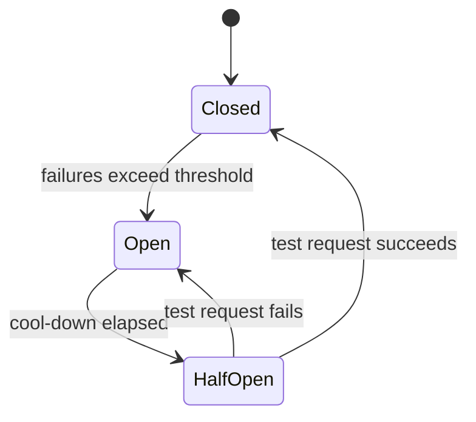

# Reliability Patterns: Timeouts, Retries, Circuit Breakers, Rate Limits

> **In one sentence:** in distributed systems things fail all the time, so services protect themselves and each other with timeouts, careful retries, circuit breakers, and rate limits.

## Everyday analogy

You call a friend who doesn't pick up. You don't keep the phone ringing forever (**timeout**). You try again in a few minutes, not every second (**backoff**). If their phone has been off all day, you stop calling for a while (**circuit breaker**). And a call center only answers so many calls per minute before saying "please call back later" (**rate limiting**).

## See it in action: circuit breaker

<em>Interactive animation available on the website.</em>

Make the downstream service fail. After several failures the breaker **opens** and fails fast; after a cool-down it goes **half-open** and lets a test request through.

## See it in action: token bucket rate limiter

<em>Interactive animation available on the website.</em>

Each request takes a token. Tokens refill at a steady rate. Bursts are allowed until the bucket is empty; then requests are rejected (HTTP 429).

## The patterns

| Pattern | What it does | Rule of thumb |
|---------|--------------|---------------|
| **Timeout** | Stop waiting after N ms | Every network call needs one; set it from the callee's p99 |
| **Retry with exponential backoff + jitter** | Retry after 100 ms, 200 ms, 400 ms… with randomness | Only retry idempotent operations; cap attempts (e.g., 3) |
| **Idempotency key** | Same request ID → same result, no duplicate side effect | Required for payments, orders, anything with side effects |
| **Circuit breaker** | After many failures, fail fast instead of calling | Prevents piling up threads on a dead dependency |
| **Bulkhead** | Separate pools per dependency | One slow dependency can't use up all threads |
| **Rate limiting** | Cap requests per client per time window | Protects fairness and capacity |
| **Load shedding** | Reject low-priority work when overloaded | Better to serve 80% well than 100% badly |
| **Graceful degradation** | Fall back to simpler behavior | Feed without ranking, cached results, disable extras |

### Why jitter matters

If 10,000 clients all retry at exactly 1 s, 2 s, 4 s, they hit the recovering service in synchronized waves (a **thundering herd**). Random jitter spreads them out.

## Measuring reliability

- **SLI** (indicator): e.g., % of requests under 300 ms and successful.
- **SLO** (objective): e.g., 99.9% over 30 days.
- **Error budget:** 0.1% of 30 days ≈ **43 minutes** of allowed failure per month.

| Availability | Downtime per year |
|--------------|-------------------|
| 99% | 3.65 days |
| 99.9% | 8.8 hours |
| 99.99% | 53 minutes |
| 99.999% | 5.3 minutes |

## Where it shows up

[Rate Limiter](../../classic-system-design/02-rate-limiter.md), [Payment System](../../classic-system-design/12-payment-system.md) (idempotency), [Notification System](../../classic-system-design/05-notification-system.md) (retries, DLQ).

## Quick check

**Q: Service A calls B with 3 retries; B calls C with 3 retries. C is down. How many calls hit C per user request?**

A: Up to 4 × 4 = 16 (each layer makes 1 attempt + 3 retries). Retries multiply across layers — retry at one layer only, or use retry budgets.

**Q: Which requests are safe to retry automatically?**

A: Idempotent ones — reads, PUT/DELETE by ID, or writes carrying an idempotency key.
