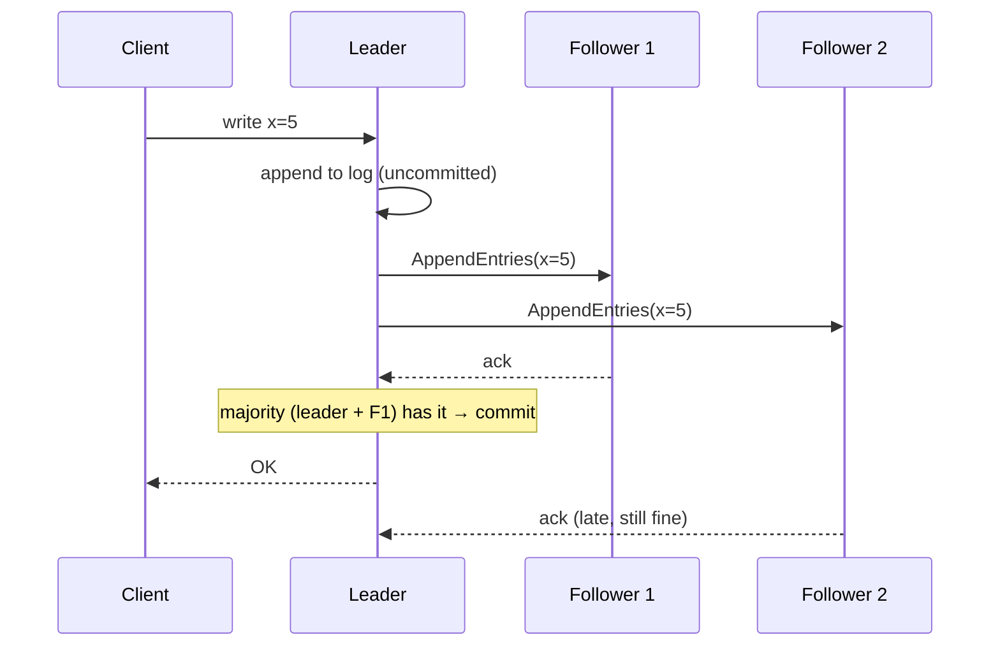

# Consensus & Leader Election (Raft)

> **In one sentence:** consensus lets a group of machines agree on one ordered history of changes — even when some of them crash — as long as a **majority** is alive; Raft does it by electing a single leader that replicates a log.

## Everyday analogy

A five-person committee keeps the official minutes. One person is chair and writes each decision down; a decision counts once a **majority** (3 of 5) has copied it into their notebooks. If the chair stops responding, the others wait a random moment, then someone nominates themself; whoever gets 3 votes becomes the new chair. With only 2 people left in the room, nothing can be decided — better no decision than two conflicting ones.

## See it in action

<em>Interactive animation available on the website.</em>

Kill the leader and watch a new election (the term number goes up). Kill two more nodes and see that with no majority nobody can become leader. Make client writes and watch entries commit once a majority has them.

## Why consensus matters

Many systems need a single source of truth that survives failures:
- **Leader election** — exactly one primary database, one scheduler owner, one lock holder.
- **Configuration and metadata** — Kubernetes stores cluster state in **etcd** (Raft); Kafka's KRaft controller, CockroachDB, TiKV, Consul all use Raft.
- **Distributed locks and coordination** (ZooKeeper uses a similar protocol, ZAB).

## How Raft works

### Roles and terms
- Each node is a **follower**, **candidate**, or **leader**.
- Time is divided into **terms** (1, 2, 3…); each term has at most one leader. Higher terms always win — a node seeing a higher term steps down to follower.

### Leader election
1. Followers expect periodic **heartbeats** from the leader.
2. If a follower's **randomized election timeout** expires (e.g., 150–300 ms), it becomes a candidate, increments the term, votes for itself, and asks others for votes.
3. Each node votes for **at most one candidate per term**, and only if the candidate's log is at least as up to date as its own.
4. A candidate with votes from a **majority** becomes leader and starts sending heartbeats.
5. Randomized timeouts make split votes rare; if one happens, a new election starts with a higher term.

### Log replication
1. Clients send writes to the leader, which appends them to its log.
2. The leader sends entries to followers (in heartbeats / AppendEntries).
3. Once a **majority** has stored an entry, it is **committed** and applied to the state machine; the leader replies to the client.
4. Followers with missing or conflicting entries are brought in line with the leader's log.

## Majorities (quorums)

| Cluster size | Majority | Failures tolerated |
|--------------|----------|--------------------|
| 3 | 2 | 1 |
| 5 | 3 | 2 |
| 7 | 4 | 3 |

- Use **odd** sizes: 4 nodes tolerate only 1 failure, same as 3, but cost more.
- Any two majorities overlap in at least one node — that's why a committed entry can never be lost and two leaders can't both commit in the same term.
- Raft is **CP**: without a majority (e.g., a network partition leaves 2 of 5 on one side), the minority side refuses writes rather than diverging. See [CAP](07-cap-and-consistency.md).

## Practical notes

- **Don't implement consensus yourself** in production — use etcd, ZooKeeper, Consul, or a database built on Raft.
- Writes cost a round trip to a majority → keep consensus groups small (3–5 nodes) and close together (one region, multiple zones).
- **Leases & fencing tokens:** a leader that was partitioned away might still think it's leader; storage systems should reject writes carrying an old term/token.
- Scale by running **many Raft groups** (one per data shard), as CockroachDB/TiKV do.

## Where it shows up

[Distributed KV Store](../../classic-system-design/06-distributed-key-value-store.md) (strong-consistency follow-up), [Message Queue](../../classic-system-design/13-distributed-message-queue.md) (controller quorum), [Job Scheduler](../../classic-system-design/16-distributed-job-scheduler.md) (shard leases in etcd), [Kubernetes architecture](../../devops/05-kubernetes-architecture.md) (etcd).

## Quick check

**Q: A 5-node Raft cluster is split by a network partition into 3 nodes and 2 nodes. What happens on each side?**

A: The 3-node side can elect a leader (majority) and keep accepting writes. The 2-node side can't reach a majority, so it can't elect a leader or commit writes. When the partition heals, the minority nodes catch up from the leader.

**Q: Why are election timeouts randomized?**

A: If all followers timed out at the same moment, they'd all become candidates and split the votes repeatedly. Randomness makes one node usually time out first and win before others start.
