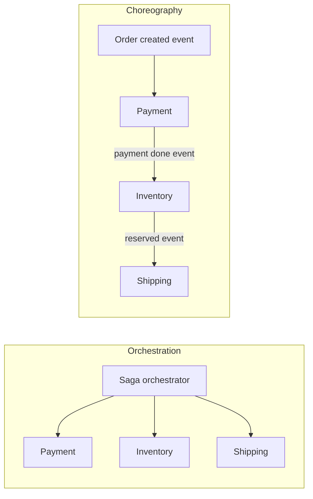

# Distributed Transactions: Two-Phase Commit & Sagas

> **In one sentence:** when one business operation touches several services or databases, you either lock everything and commit together (**two-phase commit**) or run a chain of local steps with **compensating actions** to undo them on failure (**saga**).

## Everyday analogy

Booking a trip: flight, hotel, and car. **Two-phase commit** is a travel agent who asks all three to *hold* a reservation, and only when all three say "held" tells them all to confirm — everyone waits on the agent meanwhile. A **saga** is booking them one by one yourself; if the car rental fails, you **cancel** the hotel and flight you already booked (maybe with a fee) — a semantic undo, not time travel.

## See it in action

<em>Interactive animation available on the website.</em>

Run the saga with a failure at Inventory and watch compensations run in reverse. Switch to two-phase commit and notice how participants hold locks while waiting for the coordinator.

## The problem

In a monolith with one database, an order is one ACID transaction. With microservices (order, payment, inventory, shipping each owning its database), there is no single transaction — a crash halfway could charge the card without reserving stock.

## Two-phase commit (2PC)

1. **Prepare phase:** the coordinator asks every participant "can you commit?" Each does the work, writes it durably, **locks** the affected rows, and votes YES or NO.
2. **Commit phase:** if all voted YES, the coordinator tells everyone to COMMIT; otherwise ABORT. Participants then release locks.

| Pros | Cons |
|------|------|
| True atomicity and isolation | Locks held across network round trips → low throughput |
| Familiar ACID semantics | **Blocking:** if the coordinator dies after prepare, participants wait (holding locks) until it recovers |
| Supported by some databases (XA) | All participants must support the protocol; poor fit across services/HTTP APIs and third parties |

Use 2PC inside a single distributed database (Spanner, CockroachDB do it internally with consensus-replicated participants), rarely across microservices.

## Sagas

A saga is a sequence of **local transactions**, each committing immediately in its own service. For every step there's a **compensating action**:

| Step | Compensation |
|------|--------------|
| Create order (PENDING) | Cancel order |
| Charge payment | Refund payment |
| Reserve inventory | Release inventory |
| Book shipping | Cancel shipment |
| Confirm order | — (last step) |

If step *k* fails, run compensations for steps *k−1 … 1* in reverse order.

### Orchestration vs choreography

| | Orchestration | Choreography |
|---|---|---|
| How | A central workflow tells each service what to do | Services react to each other's events |
| Pros | Flow is explicit, easy to monitor and change | Loose coupling, no central component |
| Cons | Orchestrator is another service (use a durable workflow engine) | Flow is implicit; hard to follow and debug as it grows |

### Making sagas safe

- **Idempotent steps and compensations** (retries happen) — use idempotency keys.
- **Durable saga state** (a workflow engine like Temporal, or a state table) so a crash resumes the saga.
- **Transactional outbox:** write the local change and the outgoing event in the same DB transaction.
- **Lack of isolation:** intermediate states are visible (an order is PENDING while payment runs). Design for it: semantic locks (status fields), "pending" UI states, reordering steps so risky/irreversible ones (shipping, emails) come last.
- Some actions can't be undone (an email sent) → put them at the end, or compensate with a follow-up ("sorry, your order was cancelled").

## Choosing

| Situation | Use |
|-----------|-----|
| One database, even if sharded by a distributed SQL engine | Its native transactions |
| Several of your own services, long-running or crossing third parties | **Saga** (usually orchestrated) |
| Need strict atomic isolation across a few resources you control, short duration | 2PC (accept the blocking risk) |
| You can redesign boundaries | Put data that must change together in the same service/database |

## Where it shows up

[Payment System](../../classic-system-design/12-payment-system.md), [Hotel Reservation](../../classic-system-design/20-hotel-reservation.md), [Ticket Booking](../../classic-system-design/14-ticket-booking.md), [AI Agent Platform](../../ai-system-design/05-ai-agent-platform.md) (durable workflows).

## Quick check

**Q: In a saga, payment succeeded but inventory reservation failed. What happens?**

A: The orchestrator runs compensations in reverse: refund the payment, then cancel the order. The system ends consistent, though for a short time the charge was visible.

**Q: Why is 2PC called a "blocking" protocol?**

A: After voting YES, a participant must wait for the coordinator's decision while holding locks; if the coordinator crashes, the participant can't safely decide on its own and stays blocked until recovery.
