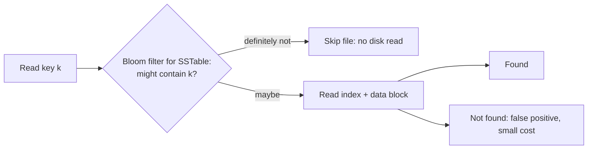

# Bloom Filters & Probabilistic Data Structures

> **In one sentence:** a Bloom filter answers "have I seen this before?" using a tiny bit array — it can say **"definitely not"** or **"probably yes"**, trading a small, tunable false-positive rate for huge memory savings.

## Everyday analogy

A bouncer with a smudged guest list: if your name clearly isn't there, you're definitely not invited. If something that looks like your name is there, you're *probably* invited — occasionally two smudges overlap and someone uninvited gets a second look at the door. The bouncer never wrongly turns away a real guest.

## See it in action

<em>Interactive animation available on the website.</em>

Add a few words, then check others. Keep adding words and watch the false-positive chance climb as more bits turn to 1.

## How it works

- A bit array of **m** bits, all 0, and **k** independent hash functions.
- **Add(x):** compute k hashes of x and set those k bits to 1.
- **Check(x):** compute the same k positions. If **any** bit is 0 → x was **definitely never added**. If **all** are 1 → x was **probably** added (or other items happened to set those bits — a false positive).

Properties:
- **No false negatives.** Ever.
- **False positives** with probability ≈ `(1 − e^(−k·n/m))^k` for n items.
- **Can't delete** items (clearing a bit could remove others). Use a **counting Bloom filter** (counters instead of bits) or a **cuckoo filter** if you need deletes.
- Optimal k ≈ `(m/n)·ln 2`.

### Sizing rule of thumb

About **10 bits per item gives ~1% false positives** (with k ≈ 7); ~14.4 bits per item gives ~0.1%.
1 billion URLs at 1% → ~1.2 GB — versus tens of GB to store the URLs themselves.

## Where Bloom filters are used

| System | Use |
|--------|-----|
| LSM-tree databases (Cassandra, RocksDB, HBase) | Skip SSTable files that can't contain a key → far fewer disk reads |
| [Web crawler](../../classic-system-design/07-web-crawler.md) | "Have we already seen this URL?" for billions of URLs |
| CDNs / caches | Only cache objects requested more than once ("one-hit wonders" filtered) |
| Browsers / security | Check a URL against a malicious-site list locally before asking a server |
| Databases & joins | Bloom-filter joins skip rows that can't match |
| Recommendations | Don't re-show items a user has already seen |

## Other probabilistic structures worth naming in interviews

| Structure | Answers | Typical use |
|-----------|---------|-------------|
| **Count-Min Sketch** | "About how many times did X occur?" (overestimates only) | Heavy hitters, trending topics ([Top-K](../../classic-system-design/17-leaderboard-top-k.md)) |
| **HyperLogLog** | "About how many *distinct* items?" (~0.8% error in 12 KB) | Unique visitors, distinct users per day (Redis `PFADD/PFCOUNT`) |
| **MinHash + LSH** | "Which documents are near-duplicates?" | Dedup ([crawler](../../classic-system-design/07-web-crawler.md), [LLM data](../../ai-system-design/25-llm-pretraining-data-pipeline.md)) |
| **t-digest / DDSketch** | Approximate percentiles (p99) mergeable across machines | Latency metrics ([monitoring](../../classic-system-design/18-metrics-monitoring.md)) |
| **Skip list** | Sorted set with O(log n) ops (exact, randomized) | Redis sorted sets |

## When not to use a Bloom filter

- When false positives are unacceptable and there's no cheap fallback check.
- When you need to list or delete members.
- When the set is small enough to store exactly (a hash set is simpler).

## Quick check

**Q: A Bloom filter says a username is "probably taken." Can you reject the signup immediately?**

A: Not safely — it might be a false positive. Use the filter to skip the database check for names that are **definitely available**, and confirm "probably taken" names with an exact lookup.

**Q: Why do LSM-tree databases keep a Bloom filter per SSTable?**

A: A read might otherwise check many files on disk. The filter rules out most files that don't contain the key with a cheap in-memory check, cutting read I/O dramatically.
