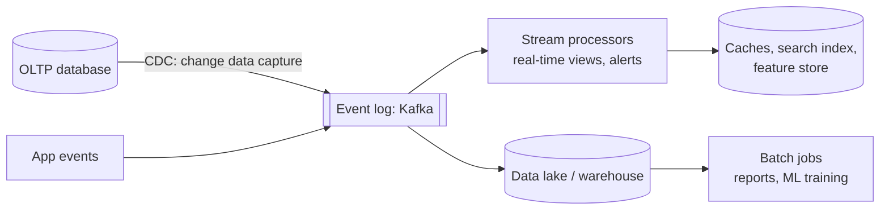

# Batch & Stream Processing

> **In one sentence:** batch processing computes results over a large, bounded dataset all at once (hours-old but complete), while stream processing updates results continuously as events arrive (seconds-old) — and modern systems combine both around an immutable event log.

> 📚 **Further reading:** *Designing Data-Intensive Applications* by Martin Kleppmann (O'Reilly), chapters "Batch Processing", "Stream Processing" and "The Future of Data Systems". This lesson is written independently as a companion.

## Everyday analogy

**Batch:** a bank prints your monthly statement — complete and correct, but once a month. **Stream:** your banking app's push notification for every card payment — instant, but it must deal with late or duplicated messages.

## See it in action: event time, windows & watermarks

<div class="sim" data-sim="stream-windows"><em>Interactive animation available on the website.</em></div>

Events are counted in the 10-second window in which they **happened** (event time), even if they arrive late. A window closes when the **watermark** passes its end. If network delay exceeds the allowed lateness, events arrive after their window closed and are dropped — counts become wrong.

## Batch processing

- Input: a bounded dataset (files in object storage/HDFS, a warehouse table). Output: derived datasets (reports, indexes, ML features, search indexes).
- **MapReduce** model: *map* each record to key-value pairs → *shuffle* by key → *reduce* each key's values. Spark and Flink-batch generalize this into dataflow graphs that keep data in memory between steps.
- Properties: inputs are immutable and jobs are deterministic → **re-run any job** after fixing a bug (human fault tolerance).
- Joins at scale: sort-merge joins, broadcast (map-side) joins for small tables, partitioned hash joins.

```python
# PySpark: daily revenue per country (batch)
orders = spark.read.parquet("s3://lake/orders/date=2026-10-17/")
(orders.filter("status = 'paid'")
       .groupBy("country")
       .agg({"amount": "sum"})
       .write.mode("overwrite").parquet("s3://lake/reports/revenue_by_country/date=2026-10-17/"))
```

## Stream processing

- Input: an unbounded stream of events (Kafka, Kinesis, Pub/Sub). Output: continuously updated results, alerts, materialized views.
- Engines: Flink, Kafka Streams, Spark Structured Streaming, Beam/Dataflow.

### Core concepts

| Concept | Meaning |
|---------|---------|
| **Event time vs processing time** | When it happened vs when we processed it. Use event time for correctness (an outage shouldn't move sales into the wrong hour). |
| **Windows** | Tumbling (fixed, non-overlapping), hopping/sliding (overlapping), session (gaps of inactivity) |
| **Watermark** | The engine's estimate that "no more events older than T are coming"; closes windows |
| **Allowed lateness / side outputs** | Accept late events for a while; route later ones elsewhere for correction |
| **State** | Counts, joins, aggregations kept in fault-tolerant local state (RocksDB) with checkpoints |
| **Exactly-once** | Checkpoints that snapshot state + input offsets together, with transactional or idempotent sinks |

### Stream joins
- **Stream–stream:** match clicks with impressions within 30 minutes (windowed join).
- **Stream–table:** enrich events with the latest user profile (table kept up to date via CDC).
- **Table–table:** maintain a materialized view of a join as both sides change.

## The log as the backbone



- **Change data capture (CDC):** stream every database change (Debezium) so caches, search indexes, and warehouses stay in sync without dual writes.
- **Event sourcing:** store the events as the source of truth; derive current state by replaying them ([stock exchange](../../classic-system-design/21-stock-exchange.md), [payments ledger](../../classic-system-design/12-payment-system.md)).
- Derived data (caches, indexes, views) can always be **rebuilt** by replaying the log.

## Lambda vs Kappa

| | Lambda | Kappa |
|---|---|---|
| Idea | Stream path for fast approximate results + batch path for correct results | Only streaming; recompute by replaying the log |
| Pros | Battle-tested, batch corrects stream mistakes | One codebase |
| Cons | Two implementations of the same logic | Needs long log retention and replay capacity |

See the [ad click aggregation](../../classic-system-design/25-ad-click-aggregation.md) problem for a full example.

## Quick check

**Q: Your hourly sales dashboard shows a dip at 14:00 and a spike at 15:00 after a 20-minute network outage. Why, and how do you fix it?**

A: Events were counted by processing time, so delayed events landed in the next hour. Window by event time with watermarks and allowed lateness (and correct very late data in batch).

**Q: Why is CDC better than writing to the database and the search index separately from application code?**

A: Dual writes can fail halfway or race, leaving the two out of sync. CDC derives the index from the database's own committed change log, in order, so the index eventually matches the database exactly.
