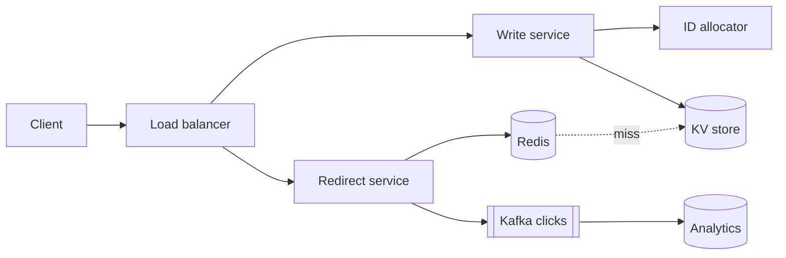

# Mock Interview 1: URL Shortener (Mid-level, 45 minutes)

> A full interviewer–candidate transcript with coaching notes. Read it once straight through, then cover the candidate's lines and answer yourself.

**Level:** Mid-level backend engineer · **Problem:** [URL Shortener](../classic-system-design/01-url-shortener.md) · **Rating at the end:** Hire

<div class="sim" data-sim="pipeline" data-title="How the 45 minutes were spent" data-steps="Clarify|Estimate|API & data|High-level design|Deep dive: IDs|Deep dive: reads|Wrap-up" data-labels="0–5 min: scope, scale, features|5–9 min: QPS, storage, cache size|9–14 min: endpoints, schema, KV store|14–22 min: write and read paths|22–32 min: counter vs hash vs ranges|32–40 min: cache, CDN, hot links|40–45 min: bottlenecks, failures, next steps"><em>Interactive animation available on the website.</em></div>

---

## 0:00 — Clarifying the problem

**Interviewer:** Let's design a URL shortener like bit.ly.

**Candidate:** Sure. Before designing, I'd like to pin down scope. The core features I'm assuming are: create a short link from a long URL, and redirect when someone visits the short link. Should I also cover custom aliases, expiration, and analytics?

**Interviewer:** Custom aliases and expiration yes. Basic click counts are nice to have.

**Candidate:** Got it. What scale should I design for — how many new links per day?

**Interviewer:** Say 100 million new links a day.

**Candidate:** And reads? I'd guess it's very read-heavy — maybe 10 reads per write?

**Interviewer:** That's reasonable.

**Candidate:** Two more: can the same long URL map to different short codes for different users? And how long must links live?

**Interviewer:** Different codes are fine. Links live for years unless they expire.

> 💡 **Coach:** Strong start. The candidate proposed defaults ("maybe 10:1?") instead of asking open-ended questions, which keeps things moving. Asking about duplicate URLs shows they're already thinking about the data model.

## 0:05 — Estimation

**Candidate:** Quick numbers. 100M writes/day divided by ~100k seconds is about **1,200 writes per second**, peak maybe 3,000. Reads at 10× are **12,000 per second**, peak around 30,000.
Each record is around 500 bytes — the long URL dominates. 100M × 500 B = 50 GB per day, so about **18 TB a year**, ~90 TB over five years. That's beyond a single machine, so we'll need to partition.
For short-code length: base62 with 7 characters gives 62⁷ ≈ 3.5 trillion combinations; five years of links is ~180 billion, so 7 characters is plenty.
Caching: traffic is skewed, so if I cache the hottest 20% of a day's reads, that's roughly 100 GB — a small Redis cluster.

**Interviewer:** Good. Why base62?

**Candidate:** Letters and digits only, so codes are URL-safe without escaping. Base64 adds `+` and `/`, which cause problems in URLs.

> 💡 **Coach:** Every number led to a decision (partitioning needed, 7 chars, cache size). That's what interviewers look for — not precision.

## 0:09 — API and data model

**Candidate:** Two main endpoints:
```
POST /api/v1/urls   { long_url, custom_alias?, expires_at? }  → 201 { short_url }
GET  /{code}        → 302 redirect to long_url (404 if missing, 410 if expired)
```
I'd use **302** rather than 301 because browsers cache 301 permanently, which would hide clicks from our analytics.

For storage, the access pattern is a single-key lookup by code, no joins. A key-value store like DynamoDB or Cassandra fits, partitioned by code:
```
urls(code PK, long_url, user_id, created_at, expires_at)
```

**Interviewer:** Why not PostgreSQL?

**Candidate:** It would work at a smaller scale and gives us transactions we don't really need. At 90 TB and 30k reads per second we'd have to shard it ourselves. A KV store gives us horizontal scaling out of the box. If the team already runs Postgres well, sharded Postgres with Citus or Vitess is also a fine answer.

> 💡 **Coach:** Justified the choice by access pattern and scale, and acknowledged the alternative. Avoid religious "NoSQL scales, SQL doesn't" claims.

## 0:14 — High-level design

**Candidate:** *(draws)* Clients hit a load balancer. Writes go to a write service: validate the URL, get a unique ID, encode it in base62, store it. Reads go to a separate redirect service: check Redis, on a miss read the KV store and populate the cache, then respond with a 302. Click events go asynchronously to Kafka, and a stream job aggregates them into an analytics store, so analytics never slows down redirects.



**Interviewer:** Why separate the read and write services?

**Candidate:** They scale very differently — reads are 10× writes and latency-critical — so we can scale and deploy them independently.

## 0:22 — Deep dive: generating codes

**Interviewer:** Let's go deeper on generating the short code. What are the options?

**Candidate:** Three main ones.
1. **Hash the URL** and take 7 characters — stateless, but collisions are possible, so I'd need check-and-retry on every write.
2. **Random 7 characters** — similar collision checks.
3. **A counter** encoded in base62 — no collisions, but a single global counter is a bottleneck and a single point of failure.

I'd pick a variant of 3: **range allocation**. Each write server leases a block of, say, a million IDs from a coordinator like ZooKeeper or a small DB table, and hands them out locally. No coordination per request, no collisions. If a server crashes, we lose part of a range — irrelevant with 3.5 trillion codes.

**Interviewer:** Sequential codes are guessable. Someone could enumerate all links.

**Candidate:** Good point. I'd pass the ID through a reversible permutation before encoding — for example a small Feistel cipher or multiplying by a large prime modulo 62⁷. Codes then look random but remain unique. I'd also rate-limit 404s per IP to make scanning expensive.

**Interviewer:** And custom aliases?

**Candidate:** Insert with a conditional write — `IF NOT EXISTS` — so two users can't claim the same alias. To avoid collisions with generated codes, I could require custom aliases to be at least 8 characters, or check generated codes against the table too, which is cheap.

> 💡 **Coach:** Listed options with trade-offs, chose one, and handled the pushback without getting defensive. The interviewer's challenge ("guessable") was a test — the candidate improved the design rather than defending the original.

## 0:32 — Deep dive: the read path

**Interviewer:** A link goes viral — a million requests per minute for one code. What happens?

**Candidate:** The cache absorbs most of it. But a single hot key in Redis lives on one shard, so I'd add:
- An **in-process cache** on redirect servers for the hottest few thousand codes (a few seconds of TTL is fine — links are immutable).
- **Request coalescing** on cache misses, so a miss triggers one DB read, not thousands.
- Serving redirects from the **CDN/edge** for very hot links.

Also negative caching for unknown codes so scanners don't hammer the DB.

**Interviewer:** How do you handle expiration?

**Candidate:** Check `expires_at` on read and return 410. Set the Redis TTL no longer than the expiry. A background job — or DynamoDB's native TTL — deletes old rows lazily.

## 0:40 — Wrap-up

**Interviewer:** Last few minutes. What are the bottlenecks and failure modes?

**Candidate:**
- **ID allocator down:** servers keep issuing from leased ranges for a while; the allocator itself runs on a replicated quorum.
- **Cache cluster loss:** reads fall to the KV store; it's sized to survive that briefly, and we warm the cache gradually.
- **Abuse:** phishing links — integrate a URL reputation check and a takedown flow; rate-limit creation per user.
- **Multi-region:** give each region its own ID range so they never collide, replicate data asynchronously, serve reads locally.

With more time I'd detail the analytics pipeline and a link-management dashboard.

**Interviewer:** Great, thanks.

---

## Interviewer's scorecard

| Area | Rating | Evidence |
|------|--------|----------|
| Requirements | Strong | Proposed sensible defaults; asked about duplicates and retention |
| Estimation | Strong | Numbers drove partitioning, code length, cache size |
| Design | Strong | Clean split of read/write paths; async analytics |
| Deep dives | Strong | ID generation trade-offs; improved design under pushback; hot-key handling |
| Communication | Strong | Narrated decisions, checked in, managed time |
| **Overall** | **Hire (mid-level)** | For senior: expected more on multi-region consistency and operational concerns unprompted |

## What to copy from this candidate

1. Propose defaults instead of asking open questions.
2. Turn every estimate into a design decision.
3. For each component: options → choice → trade-off.
4. Treat pushback as a hint, not an attack.
5. End with failure modes before being asked.
