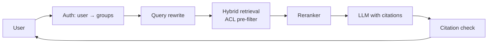

# Mock Interview 2: Enterprise RAG Assistant (AI Engineer, 45 minutes)

> Transcript of an AI system design interview, including a weak first answer and how the candidate recovered. Coaching notes explain what interviewers listen for in GenAI designs.

**Level:** Senior AI / ML engineer · **Problem:** [RAG Enterprise Assistant](../ai-system-design/01-rag-enterprise-assistant.md) · **Rating at the end:** Strong hire

<em>Interactive animation available on the website.</em>

---

## 0:00 — Clarifying

**Interviewer:** Design an assistant that answers employee questions using internal documents — Confluence, Google Drive, Slack.

**Candidate:** A few questions first. How many employees and documents? Do users have different access rights to documents? What's the quality bar — is a wrong answer worse than "I don't know"? And are there constraints on which LLMs we can use, like data leaving our cloud?

**Interviewer:** 50,000 employees, about 20 million documents. Permissions vary a lot — HR and legal docs are restricted. Wrong answers are worse than no answer. We can use a hosted model with a zero-retention agreement.

**Candidate:** What latency is acceptable, and is there a cost target?

**Interviewer:** Start streaming within two seconds. Keep it to a few cents per question.

> 💡 **Coach:** Asking "what does good mean?" and "who can see what?" before drawing anything is the #1 signal of AI design maturity. Permissions and quality bar shape the whole design.

## 0:05 — A weak first answer (and the recovery)

**Candidate:** We could fine-tune an LLM on all the company documents so it knows everything…

*(pauses)*

…actually, let me reconsider. Fine-tuning won't work well here: it doesn't reliably memorize facts, it can't enforce per-user permissions, it can't cite sources, and it goes stale the moment a document changes. **Retrieval-augmented generation** fits better: retrieve the relevant passages the user is allowed to see, then have the LLM answer from them with citations.

**Interviewer:** Good. Why is that better for permissions specifically?

**Candidate:** Because permissions are enforced at retrieval time, in code, per request. With fine-tuning, restricted knowledge is baked into weights that every user queries.

> 💡 **Coach:** Catching your own mistake out loud is fine — even positive — if you explain why. Interviewers don't expect perfection; they expect reasoning.

## 0:09 — Estimation

**Candidate:** 20M docs, maybe 10 chunks each → **200M chunks**. With 1,024-dimensional float32 embeddings that's ~800 GB; with int8 or product quantization, 100–200 GB, sharded across a few vector index nodes.
Queries: if 50k employees ask ~4 questions a day, that's 200k/day — low QPS, ~20 at peak. The cost driver is tokens: ~10 chunks × 500 tokens = 5k input tokens plus ~500 output per question → about 1 billion input tokens per day. So caching and model choice matter more than QPS.

## 0:13 — High-level design

**Candidate:** Two pipelines.

**Ingestion:** connectors pull changes from Confluence, Drive, Slack (webhooks plus periodic crawls) → parse and clean → chunk → embed → write to a vector index and a keyword index, with metadata: source, URL, last updated, and the **ACL** — which users and groups can see it.

**Query:** authenticate the user and resolve their groups → rewrite the question using chat history → hybrid retrieval **filtered by the user's groups** → rerank → build a prompt with numbered sources → stream the LLM answer → verify citations → return.

## 0:20 — Deep dive: permissions

**Interviewer:** Walk me through how you make sure nobody sees a document they shouldn't.

**Candidate:** Three layers:
1. **Pre-filter in the index:** each chunk stores allowed principals; vector and keyword searches filter on the intersection with the user's groups. Unauthorized chunks never reach the prompt — filtering after generation would be too late, because the model could already have leaked content into the answer.
2. **ACL sync:** permission changes, especially *removals*, propagate fast — update chunk metadata without re-embedding. Revocation latency is a metric with an alert.
3. **Defense in depth:** before building the prompt, re-check each chunk's document against the live ACL service.

For extremely sensitive sources like HR, I'd use separate indexes per sensitivity tier.

**Interviewer:** Filtered vector search can hurt recall when the filter is very selective. How do you handle that?

**Candidate:** Right — with HNSW, a filter that matches only 0.1% of vectors makes graph traversal inefficient. Options: partition indexes by tenant or sensitivity, fall back to brute force over the filtered set when it's small, or use an engine with filter-aware traversal. I'd measure recall on filtered queries specifically.

> 💡 **Coach:** "Filter before generation" is the key phrase. The follow-up about filtered ANN recall is a senior-level probe — knowing the failure mode earns a lot of credit.

## 0:28 — Deep dive: retrieval quality

**Candidate:** Most RAG quality problems are retrieval problems, so:
- **Chunking:** structure-aware — split by headings, keep tables intact, add the doc title and section path to each chunk so "it increased 5%" still has context. Slack: group by thread.
- **Hybrid search:** embeddings for meaning, BM25 for exact terms like error codes and product names; combine with reciprocal rank fusion.
- **Rerank** the top 50 with a cross-encoder down to 5–8.
- **Freshness:** prefer the latest version of policies; show "last updated" in citations.

## 0:34 — Evaluation

**Interviewer:** How do you know it's working?

**Candidate:** I'd separate retrieval from generation:
- **Retrieval:** a labeled set of questions → relevant documents, built with subject-matter experts and some synthetic questions; track recall@k and MRR.
- **Generation:** faithfulness (is every claim supported by sources?), relevance, correctness — graded by an LLM judge that I calibrate against human ratings.
- **Safety:** a red-team set with restricted test users — permission leakage rate must be zero.
- **Online:** thumbs up/down, rate of "I don't know", follow-up questions, support-ticket deflection.

Every change to chunking, embeddings, prompts, or model version runs this suite in CI before deployment.

> 💡 **Coach:** Separating retrieval metrics from generation metrics shows you can debug the system, not just build it.

## 0:39 — Cost, latency, failures

**Candidate:** Latency budget: auth 20 ms, rewrite ~300 ms with a small model, retrieval ~100 ms, rerank ~100 ms, LLM first token ~700 ms — under two seconds, and we stream. Cost: limit context to the top reranked chunks, route simple lookups to a smaller model, and use a semantic cache keyed by the question *and the user's permission set*. Failures: if retrieval confidence is low, the assistant says it doesn't know and links the most relevant docs; if the LLM provider is down, fail over through our gateway or show search results only.

**Interviewer:** One more: documents can contain text like "ignore your instructions." Concern?

**Candidate:** Yes, indirect prompt injection. Treat retrieved text as data with clear delimiters, don't give this assistant tools that take actions, and filter outputs. The main protection is architectural: even a manipulated model can only see documents the user was already allowed to see.

---

## Scorecard

| Area | Rating | Evidence |
|------|--------|----------|
| Problem framing | Strong | Quality bar, permissions, cost asked upfront |
| Technical judgment | Strong | Recovered from fine-tuning idea with clear reasoning |
| Depth | Very strong | ACL pre-filtering, filtered-ANN recall, chunking, reranking |
| Evaluation | Very strong | Retrieval vs generation metrics, calibrated judges, CI gates |
| Production thinking | Strong | Latency budget, cost levers, failure modes, prompt injection |
| **Overall** | **Strong hire (senior)** | |

## Takeaways for AI design interviews

1. Ask what "good" means and who can see what.
2. Explain why RAG vs fine-tuning vs agents — don't default.
3. Spend time on retrieval quality, not just the LLM.
4. Always describe evaluation: offline, online, and safety.
5. Talk about tokens, cost, latency budgets, and failure modes.
